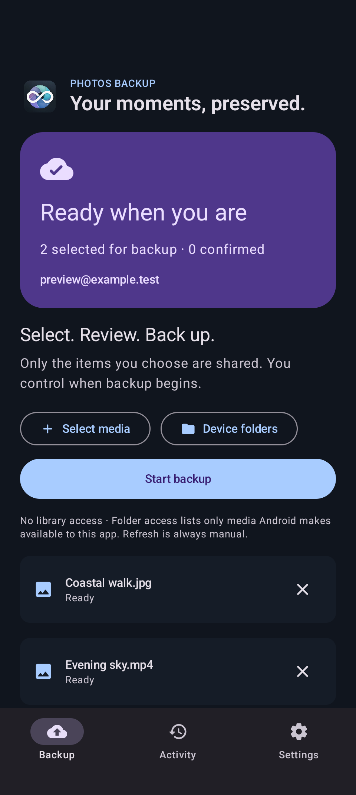

# Photos Backup for Android

A native Kotlin / Compose app for explicitly selected photos and videos. Connect Google Photos, choose **Select media** (Android's private photo picker, which needs no permission) or **Device folders** (accessible MediaStore folders, mirrored as Google Photos albums; this asks for photo and video access, and with partial access only the media you granted appears), review the list, and tap **Start backup**. There is no automatic camera roll scan, iCloud integration, or upload you did not start. Backup, Activity and Settings support light/dark appearance and use the shared app artwork.

Download `Photos-Backup-0.6.4-Android.apk` and verify it with `SHA256SUMS.txt` from the [v0.6.4 release](https://github.com/ayush5harma/google-photos-backup/releases/tag/v0.6.4). It is signed with the same key as 0.5.0, so it installs over 0.5.0 as an update. The app uses the unofficial [gpmc](https://github.com/xob0t/gpmc) API; Google can change authentication, upload behavior, or storage accounting at any time.

## Preview



## Build

Requires Java 17, Android SDK platform 36 / build-tools 36.0.0 and a host Python 3.11 (`uv python install 3.11` is one option). Set `ANDROID_HOME` to your SDK. From this directory:

```sh
./gradlew testDebugUnitTest lintDebug assembleDebug assembleRelease assembleDebugAndroidTest
python3 -m unittest discover -s tests -v
```

The Gradle 8.11.1 wrapper verifies its distribution checksum. AGP 8.9.2, Kotlin 2.1.20 and Chaquopy 17.0.0 are pinned. The universal APK includes arm64-v8a and x86_64, embedded Python 3.11 and gpmc 0.9.0. The Gradle `syncSharedBridge` task copies only `Bridge/gpmc_bridge.py` into generated build sources before every Python merge: the engine has one source of truth, no unmanaged fork or desktop test/iCloud modules in the APK. The Android Python adapter suppresses all Python logging so auth responses never reach logcat. At application startup it eagerly imports pinned gpmc while suppressing only `gpmc.client`'s terminal-only `signal.signal(SIGINT, SIG_DFL)` call; Android uses WorkManager/StopSignal cancellation instead and the original Python signal API is immediately restored.

APKs: `app/build/outputs/apk/debug/app-debug.apk` and `app/build/outputs/apk/release/app-release-unsigned.apk`. Release is unsigned unless all signing environment variables are provided: `ANDROID_KEYSTORE_PATH`, `ANDROID_KEYSTORE_PASSWORD`, `ANDROID_KEY_ALIAS`, `ANDROID_KEY_PASSWORD`. Do not store signing credentials in this tree. Version reads `Android/VERSION`, not the root `VERSION`: the APK is signed with the owner's release key outside CI, so Android moves to a new version only when a signed package is published (the root went to 0.5.1 for a desktop-only fix while Android stayed at 0.5.0).

## Authentication and privacy

This independent app uses **unofficial gpmc/Google Photos authentication**, not a supported Google OAuth integration. Google may reject embedded sign-in, device checks or uploads at any time. Sign-in displays Google's HTTPS EmbeddedSetup page inside an app-owned WebView, allows only exact Google navigation hosts, rejects invalid TLS, has no JavaScript/native bridge, and never reads passwords or page form fields. It exchanges only the completed `oauth_token` cookie through Google's legacy auth endpoint, validates Google Photos access, and clears the WebView's cookies and storage. An obscured advanced `auth_data` field in Settings is a fallback for users already using gpmc.

Credentials are AES-GCM encrypted with a nonexportable Android Keystore key and stored only under `noBackupFilesDir`. The encrypted payload and queue share an account generation so stale callbacks or interrupted account changes cannot attach confirmations to another account. Disconnect clears account and local history. App cloud backup and device transfer are disabled. Screens containing credentials block screenshots. No credentials are passed in WorkManager input data or logs.

The durable atomic queue stores selected URI grants and confirmed Google media keys. Each start freezes the selected IDs/account generation. WorkManager runs a foreground `dataSync` worker with a cancellable notification that shows items backed up and the upload speed in MB/s. SAF URIs are streamed to private temporary cache files and hashed in batches of up to 32 items or 400 MB; while one batch uploads, the next is staged, the two together within 1 GB of cache and leaving 1 GB of the volume allocatable. Staging files are removed after each batch and on every exit path, and orphaned staging files are removed at process startup. A backup is confirmed only on a nonempty Google `media_key`. Interrupted runs retain confirmations and can be started again for remaining items; gpmc's remote hash lookup handles already committed files.

Cancel prevents later items from starting and propagates into the bridge on progress/event callbacks. Uploads already in flight (as many as go at once) can finish at Google before the next callback or timeout; a confirmation that arrives is saved before cancellation is observed, and gpmc's hash check finds the others on the next run. Android foreground service/time quotas and OEM power controls still apply; this is not an unlimited background uploader. Only user-selected media is uploaded.

Quality profiles expose the shared gpmc engine's original/Pixel XL, saver/Pixel 2 and original-with-quota options. Google alone decides storage charging. On 2026-10-16, a real selected photo and video appeared in Google Photos as Original quality without account-storage use, and downloaded originals matched their source SHA-256 hashes. That validates those fixtures only; it does not promise unlimited storage. See the [live validation report](https://github.com/ayush5harma/google-photos-backup/releases/download/v0.4.0/live-validation.md).

## Upload speed

Each batch goes to the bridge as one request with several uploads at once. **Settings > Uploads at once** has two modes, as on the Mac: **Automatic** (the default) starts at 4 and adds one per batch while each step is at least 10% faster, measures a step again rather than stopping at one slow batch (phone uplinks are noisy), halves on Google's HTTP 429 (and the run pauses 30 s before the next batch) and takes one off after two retryable failures in a request; a **chosen number** is exactly that many. Both stay within 8 on Wi-Fi and other unmetered networks and 2 on a metered network, rechecked every batch, for battery and heat. One gpmc client, its bearer token and the bridge's kept connections serve every request of a worker run (`android_bridge.Session`, the bridge's own `ClientCache`), so a run signs in once instead of once per item and reuses its TLS connections; they are closed when the worker ends. The quality is sent unchanged at every level: Original is gpmc `saver=False, use_quota=False` (Pixel XL), asserted for every upload at 1 to 8 at once by `tests/test_android_bridge.py`.

## Verification

Host unit tests check navigation boundaries, confirmation requirements, malformed account data, the parallelism controller, the staging window, failure classification and the speed meter. Python adapter tests use mocked bridge execution to check malformed requests and cancellation ordering without network or credentials, and a fake gpmc client to check that a run signs in once and reuses its connections, that uploads really run in parallel, and the Original-quality flags at every thread count.

`src/debug` alone contains `DebugBackupWorker` and `debug_backend.py`. The instrumentation smoke tests generate a 2×2 PNG and synthetic credentials, then run the real staging/queue/Keystore/bridge path with a synthetic backend for success, failure and cancellation, and reject stale-account callbacks. No fixture backend, fixture worker, exported test activity, or hidden settings switch is packaged in release.

```sh
./gradlew connectedDebugAndroidTest
```

Run that command only on an explicitly authorized test device: the tests clear this app's local account/queue and never use owner media or Google credentials. Real Google sign-in and one explicitly selected photo/video still require an owner-assisted live acceptance test.

On 2026-10-16, the release APK installed and launched on a Pixel 9 Pro (Android API 37). Eight device tests passed, including the real bundled engine import, synthetic upload/failure/cancellation, account isolation, interrupted persistence, and cancelled sign-in validation. The adaptive launcher icon and a real Google sign-in/upload were checked on-device.

## Credits

See [ACKNOWLEDGEMENTS.md](../ACKNOWLEDGEMENTS.md) for the open-source projects that make this app possible, including gpmc.
