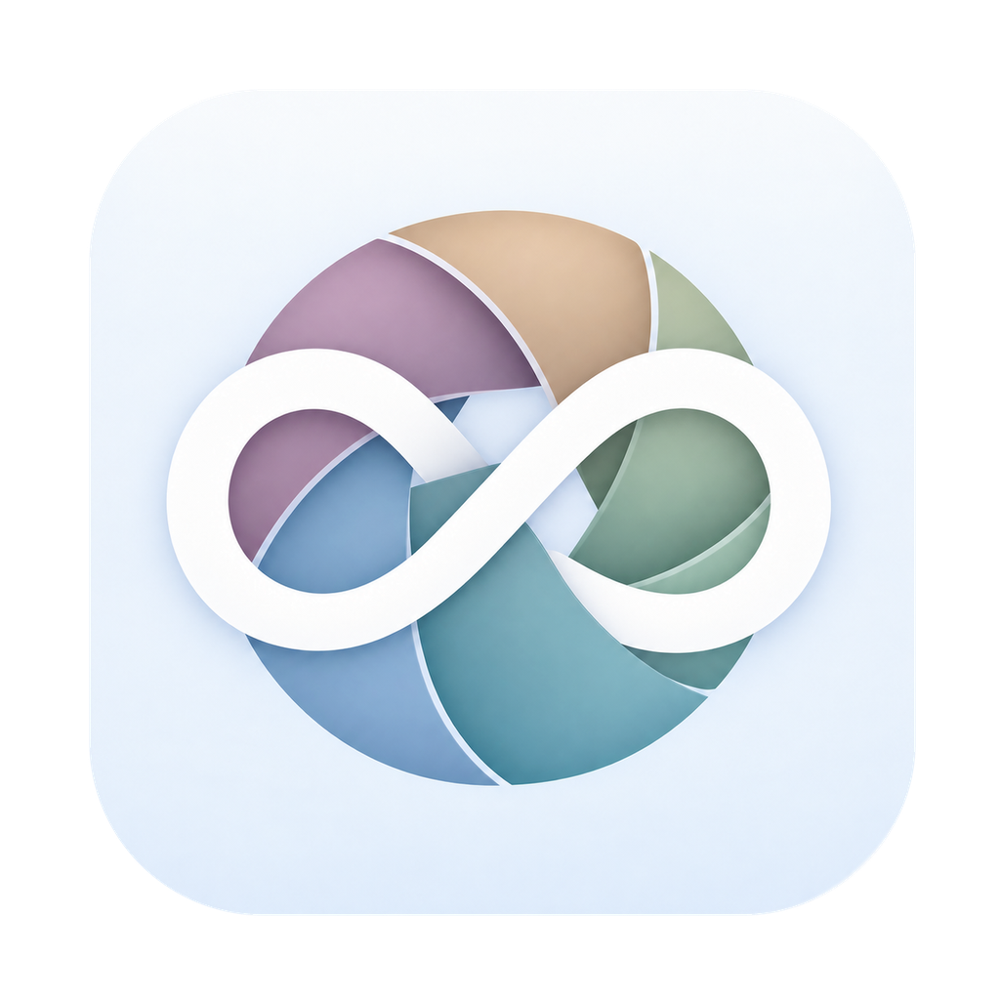
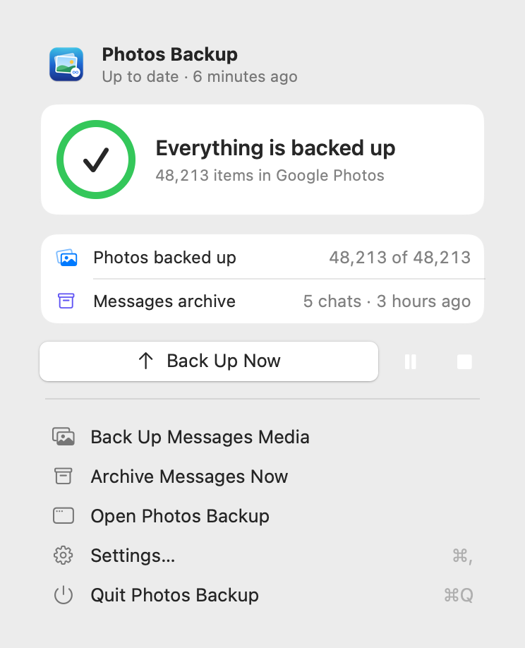
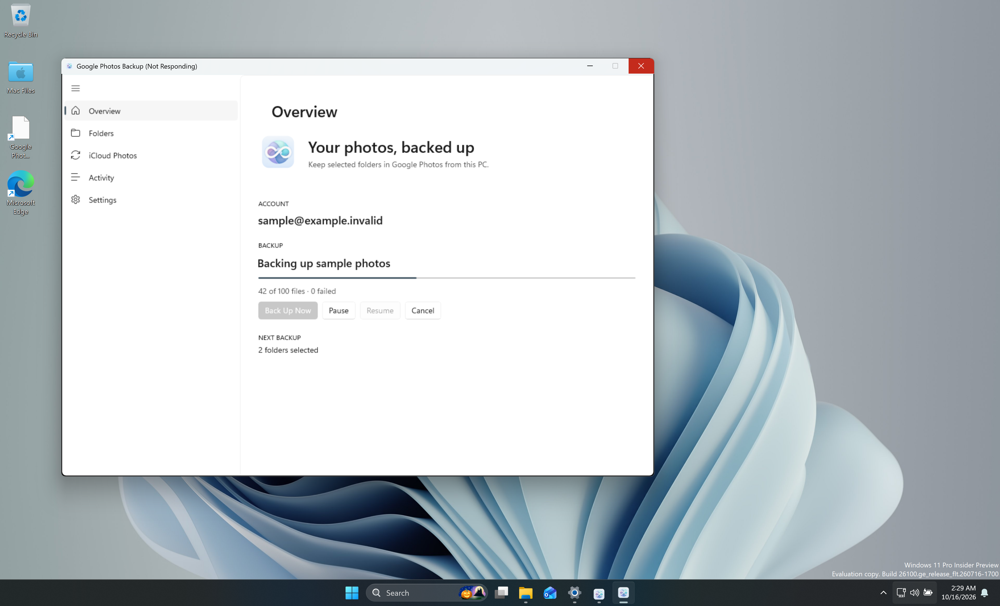
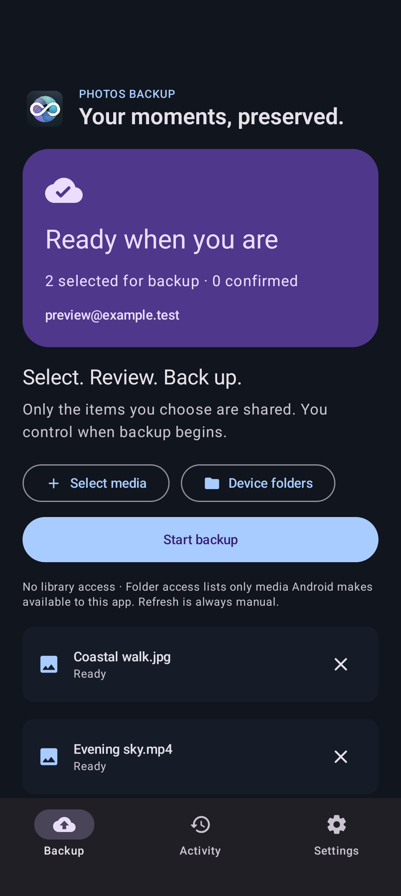
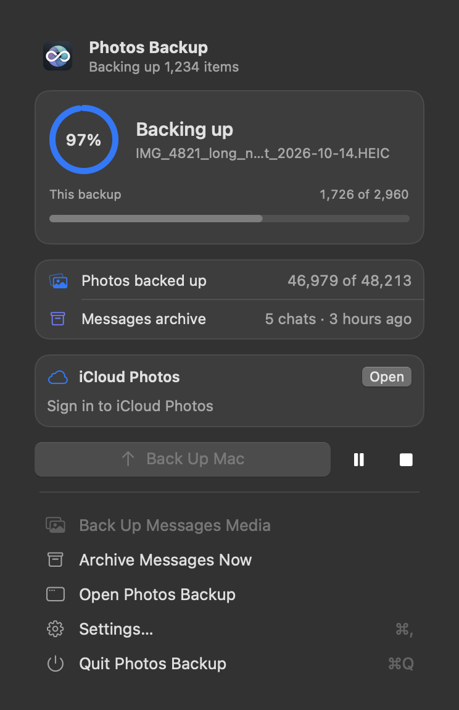
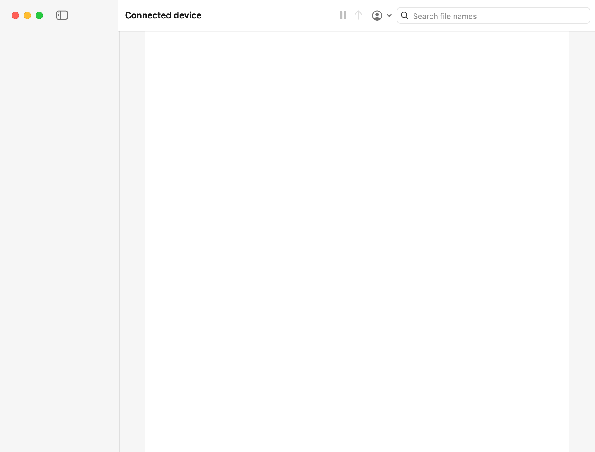
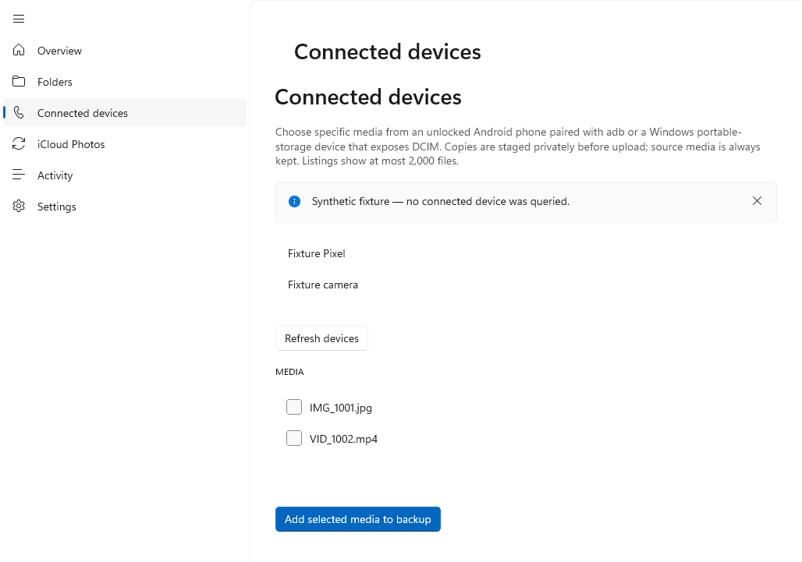

# Photos Backup

<picture>
  <source media="(prefers-color-scheme: dark)" srcset="docs/app-icon-dark.png">
  
</picture>

Back up selected photos and videos to Google Photos from **macOS, Windows, or Android**. The apps keep your originals by default and include a **currently working unlimited original-quality mode** through the unofficial gpmc client. [Validation and limits](#upload-mode-and-its-limits).

[Website](https://ayush5harma.github.io/google-photos-backup/) · [Download v0.5.0](https://github.com/ayush5harma/google-photos-backup/releases/latest) · [Setup](docs/SETUP.md) · [Reference](docs/REFERENCE.md) · [Credits](ACKNOWLEDGEMENTS.md)

## Start here

1. Install the current v0.5.0 release for your platform below.
2. Pick a small source and review automatic backup settings (on by default on Mac), then connect Google Photos and run a backup.
3. Check the uploaded item in Google Photos, including its quality and storage details, before trusting a larger backup.

| Platform | v0.5.0 download |
| --- | --- |
| macOS 14+ | [Apple silicon DMG](https://github.com/ayush5harma/google-photos-backup/releases/download/v0.5.0/Photos-Backup-0.5.0-macOS-arm64.dmg) · [Intel DMG](https://github.com/ayush5harma/google-photos-backup/releases/download/v0.5.0/Photos-Backup-0.5.0-macOS-x86_64.dmg) |
| Windows 10 1809+ (x64) / Windows 11 (ARM64) | [ARM64 installer](https://github.com/ayush5harma/google-photos-backup/releases/download/v0.5.0/Google-Photos-Backup-0.5.0-Windows-arm64-Setup.exe) · [Intel/AMD x64 installer](https://github.com/ayush5harma/google-photos-backup/releases/download/v0.5.0/Google-Photos-Backup-0.5.0-Windows-x64-Setup.exe) |
| Android 8+ | [APK — ARM64 and x86_64](https://github.com/ayush5harma/google-photos-backup/releases/download/v0.5.0/Photos-Backup-0.5.0-Android.apk) |

`SHA256SUMS.txt` in the [v0.5.0 release](https://github.com/ayush5harma/google-photos-backup/releases/download/v0.5.0/SHA256SUMS.txt) covers every package. The Mac app is ad-hoc signed and not notarized; Windows installers are unsigned previews.

## Upload mode and its limits

Photos Backup uses [xob0t's gpmc](https://github.com/xob0t/gpmc), an unofficial Google Photos client. Its Pixel XL profile currently produced **Original quality** uploads that did **not** count against Google account storage in our finite live tests. Google can change authentication, upload behavior, or storage accounting at any time, so this is neither a guarantee nor an entitlement for every account or file.

On 16 October 2026, a photo and video from each supported platform were read back from Google Photos with SHA-256 hashes matching the originals. The tested Mac albums and Windows folders also had their expected names and contents. See the [validation report](https://github.com/ayush5harma/google-photos-backup/releases/download/v0.4.0/live-validation.md).

## What’s new in v0.5.0

Disposable files passed import and byte-for-byte Google original readback: iPhone on Mac, and iPhone and Pixel through Windows production components. Android folder backup and album creation passed the owner’s on-device check, and its responsive layout passed device tests and scrcpy inspection. Live iCloud reclaim validation remains pending. [Validation](docs/VALIDATION-v0.5.0.md).

- **Android:** select accessible MediaStore folders and mirror them as Google Photos albums. These are device folders, not logical Google albums. Android's partial-media permission means only media you granted the app can appear.
- **macOS:** import selected originals from a connected, unlocked and trusted iPhone or camera through DCIM/Image Capture. This is file import, not PhotoKit album access or cloud-only media.
- **Windows:** import selected media from devices exposed through Windows portable storage/DCIM. An optional, explicitly configured ADB source can import from a wireless Android connection.
- **iCloud reclaim (experimental):** iCloud backup remains copy-only by default. A manual preview, or an explicitly confirmed automatic run of at most 100 items, may move verified source assets to Recently Deleted only after fresh original readback and SHA-256 verification of every component. Recently Deleted changes propagate to iCloud devices; it does not promise immediate free space or purge the items.

## Know before backing up

- macOS can recreate selected Apple Photos albums. Windows mirrors selected folder names. Android selects individual files or accessible device folders.
- Live Photos and other paired components need special care. The Mac Photos-library source currently uploads the still image; connected-device reclaim requires every identified paired component.
- Selected media and associated metadata go to your Google account. Credentials stay in macOS Keychain, Windows DPAPI, or Android Keystore; local history stays on your device.

## Screenshots

Screenshots use synthetic data; they are not live-upload evidence.

| macOS | Windows |
| --- | --- |
|  |  |

Android and dark mode

Android image shows v0.5.0 with synthetic account and media data.

See [detailed setup](docs/SETUP.md), the [technical reference](docs/REFERENCE.md), [Windows guide](Windows/README.md), and [Android guide](Android/README.md). Developers can start with [CONTRIBUTING.md](CONTRIBUTING.md).

Connected iPhone import — v0.5.0

<picture>
  <source media="(prefers-color-scheme: dark)" srcset="docs/macos-connected-device-dark.png">
  
</picture>

Connected-device import on Windows — v0.5.0

<picture>
  <source media="(prefers-color-scheme: dark)" srcset="docs/windows-connected-device-dark.png">
  
</picture>

The `--device-smoke` fixture supplies synthetic media and does not query connected devices.

## Credits

Made possible by [gpmc](https://github.com/xob0t/gpmc) and [gotohp](https://github.com/xob0t/gotohp) by **xob0t**, [iCloud Photos Downloader](https://github.com/icloud-photos-downloader/icloud_photos_downloader), and the projects listed in [Acknowledgements](ACKNOWLEDGEMENTS.md). Photos Backup is [MIT licensed](LICENSE); upstream projects retain their own licenses.
