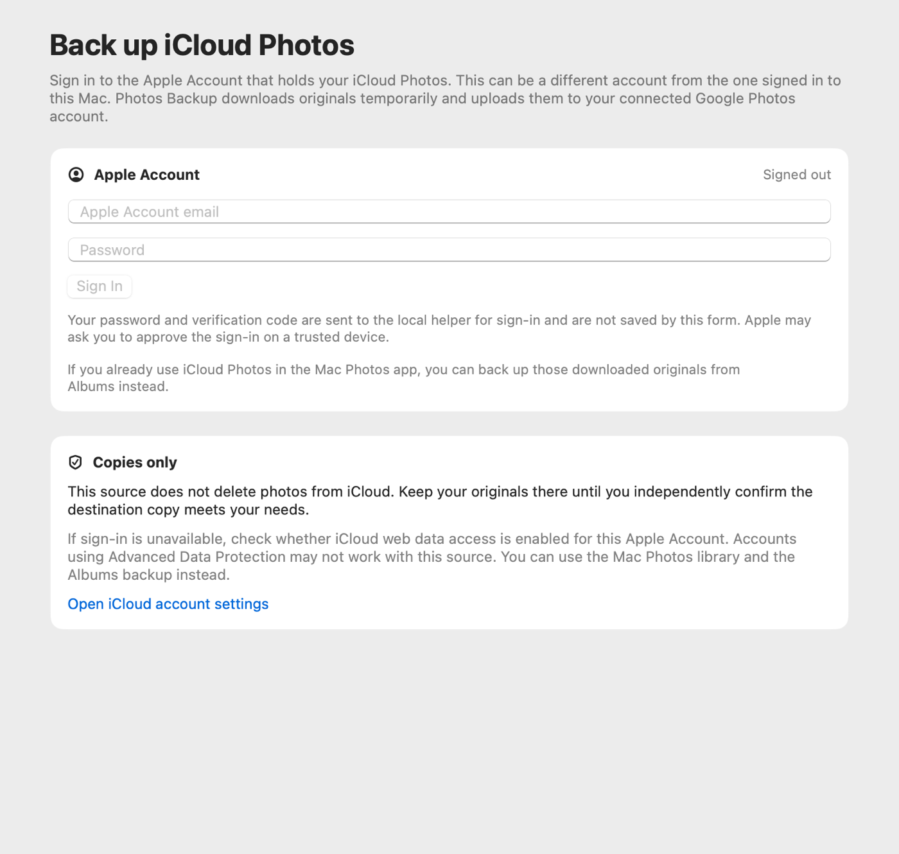
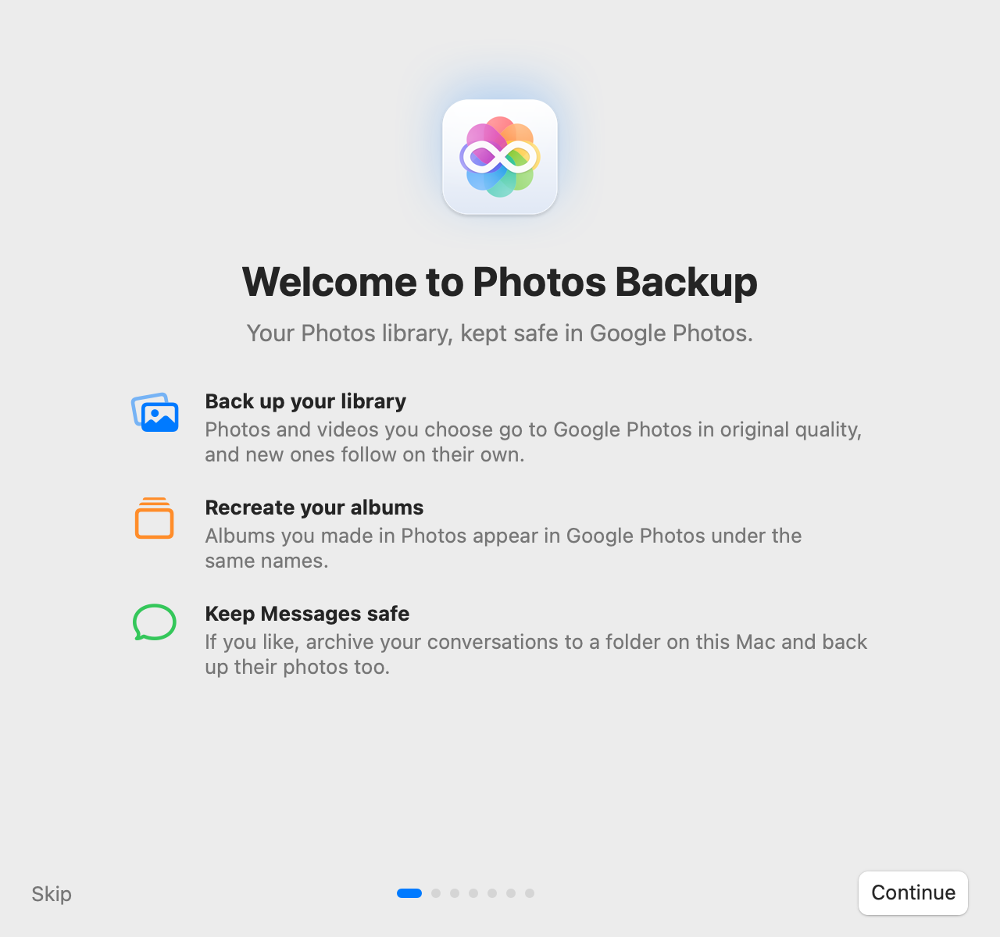

# Google Photos Backup for macOS and Windows

<p align="center"><picture>
  <source media="(prefers-color-scheme: dark)" srcset="docs/app-icon-dark.png">
  
</picture></p>

Native desktop backup to Google Photos, with an unlimited original-quality upload mode through gpmc. The released macOS app backs up your Apple Photos library; the Windows WinUI 3 preview backs up folders of photos and videos.

On macOS, choose albums or your whole library, then follow progress from the menu bar. Photos Backup can also upload photos and videos from Messages and keep a readable, local archive of your conversations.

Uploads use [gpmc](https://github.com/xob0t/gpmc), an unofficial Google Photos client. Its **Pixel XL original-quality mode** is intended to use Google's unlimited original-quality storage behavior. Google controls whether uploads work and how they count against storage, and can change either behavior. Check your Google Photos account's storage after your first backup. Photos Backup is an independent project, unaffiliated with Apple or Google.

[Download for macOS](https://github.com/ayush5harma/google-photos-backup/releases/latest) · [Set up](#set-up-on-macos) · [Privacy](#privacy) · [Technical reference](docs/REFERENCE.md) · [Contribute](CONTRIBUTING.md)

## Download

Download the **macOS Apple silicon (arm64)** or **macOS Intel (x86_64)** ZIP from the [latest release](https://github.com/ayush5harma/google-photos-backup/releases/latest). Version 0.2.0 supports macOS 14 or later. The prebuilt app includes its uploader; you do not need Xcode, Python, uv, or other developer tools.

Unzip the download, move **Photos Backup.app** to Applications, and open it. The app is currently signed ad hoc and is **not notarized by Apple**. If macOS blocks its first launch, find the blocked app in **System Settings > Privacy & Security**, choose **Open Anyway**, and confirm the prompt only if you trust this download. Keep macOS security protections on. The app name remains **Photos Backup.app** so existing installs retain their identity.

**Windows:** A native WinUI 3 x64 preview is included in this repository. See [Windows setup and source builds](Windows/README.md). It is under testing and has no stable release yet.

## Set up on macOS

1. Open **Photos Backup.app** and follow the welcome guide. Grant Photos access so the app can read the library and albums you want to back up.
2. Choose **Sign In with Google**. Sign in on Google's page inside the app and complete the consent step. Photos Backup stores the resulting credential in your macOS login Keychain.
3. Choose **All Photos** for the whole library, or select albums in **Albums**. You can change the selection later. Photos kept only in iCloud are downloaded by Photos when the app exports them.
4. Choose **Back Up Now** in the window or menu bar panel. The menu bar shows progress, and **Activity** shows recent runs and failed items. Leave the app running for automatic backups; **Settings > General > Open at login** can start it when you sign in to your Mac.

Automatic backups are on by default after the welcome guide. They run when the library changes, at launch, after wake, and periodically. You can pause, stop, or retry failed items. The app reads Apple Photos and uploads copies; it never deletes media from your Mac or Google Photos. Edited photos can be uploaded again, so Google Photos may contain both versions.

## iCloud Photos backup (source builds)

The iCloud source is available in current source builds on macOS and Windows; it is not included in the older macOS v0.2.0 release. You do not need to be signed in to iCloud in macOS System Settings or have iCloud for Windows installed.

1. Connect your destination Google account in the app.
2. Open **iCloud Photos**, enter your Apple Account, and follow the sign-in prompts. Enter your password in the app and complete Apple's verification code prompt when requested.
3. Once connected, start the iCloud backup. Keep the app open while it downloads originals and uploads them to Google Photos. Use the source's pause/resume controls to continue an interrupted transfer. iCloud backups are started manually; the existing automatic Photos Library schedule does not run this source.
4. If the session expires, return to **iCloud Photos** and sign in again. A previous desktop iCloud or `icloudpd` sign-in does not guarantee that this app has a usable session.

The sign-in flow supports Apple two-factor authentication. Legacy two-step verification accounts are not supported; the app explains this instead of repeatedly asking for a code.

Direct iCloud access depends on Apple's web access being available. Accounts with Advanced Data Protection may not support this provider. The app does not change your account's protection settings. If web access is unavailable, use the macOS Photos Library source or download originals using Apple's tools and back up a local folder on Windows.

Apple session material is stored in macOS Keychain or encrypted with Windows DPAPI. Passwords and verification codes are passed to the bundled helper through a pipe and are not saved by the form. The helper uses a private temporary cookie directory while running; a forced termination can leave it until the next helper launch cleans it up.

This integration currently copies media and retains the iCloud originals. Automatic iCloud deletion is unavailable until the destination can be independently verified. Upload completion alone is not a safe basis for reclaiming iCloud storage. [Issue #7](https://github.com/ayush5harma/google-photos-backup/issues/7) tracks that remaining work.

<picture>
  <source media="(prefers-color-scheme: dark)" srcset="docs/icloud-setup-dark.png">
  
</picture>

The shared provider follows the transfer and resumability approach in [icloud-to-google-photos](https://github.com/ayush5harma/icloud-to-google-photos), using [iCloud Photos Downloader](https://github.com/icloud-photos-downloader/icloud_photos_downloader) for iCloud access and this app's existing Google uploader.

## A look at the app

[](docs/menu-bar-panel-light.png)
[](docs/menu-bar-panel-backing-up-dark.png)

<details><summary>See the welcome guide</summary>

[](docs/welcome-guide-light.png)

</details>

<a href="Windows/README.md"><picture>
  <source media="(prefers-color-scheme: dark)" srcset="docs/windows-overview-dark.png">
  
</picture></a>

The Windows image shows the native preview with an opaque capture background.

These screenshots use [made-up fixture data](docs/SCREENSHOTS.md), not a real library, account, or conversation.

## What gets backed up

- **Photos and albums.** A photo selected through several albums uploads once. Photos Backup can recreate your own album names in Google Photos. Live Photos currently upload as still images.
- **Messages media, optional.** Turn on **Back up photos and videos from Messages** in Settings to upload locally available attachments. Message text, chat names, and contacts are not uploaded.
- **Messages archive, optional.** Turn on **Keep an archive of my messages** for browsable conversations, attachments, and dated database copies. The default folder is `~/Messages Archive`; you can choose another. If it syncs through a cloud service, the archive is stored there too. Later edits and unsends replace the displayed text; the archive can also retain text it saw before the change. Messages deleted from the Mac remain in the archive.

Both Messages features are off by default and need **Full Disk Access** for Photos Backup under **System Settings > Privacy & Security > Full Disk Access**. Contacts access is optional and only helps show names in the local archive.

## Privacy

On Windows, selected files and mirrored folder names go to Google Photos. Settings, run history, and resume state stay in `%LOCALAPPDATA%\GooglePhotosBackup`; the credential is encrypted using Windows DPAPI for your Windows account. See the [Windows guide](Windows/README.md) for preview limitations.


Selected media, capture dates, and album names go to your connected Google Photos account. Backup state and logs stay under the app's Application Support folder; temporary upload copies are removed after each batch. Your Google credential stays in the login Keychain and is passed to the uploader through a pipe. A Messages archive stays in its chosen folder, with owner-only file permissions. If you choose a cloud-synced folder, that provider can receive the archive. The app does not modify your Photos library or Messages database.

The uploader uses a reverse-engineered Google API. Upload availability, quality handling, and storage accounting may change without notice. The Pixel XL profile does not guarantee unlimited storage for your account. See [limitations and operational details](docs/REFERENCE.md#not-done-yet) and [security reporting](SECURITY.md).

## Automate it

Use a `photosbackup://` link in a macOS Shortcut's **Open URLs** action, or open one from a terminal. The links run the same actions as the app's buttons.

| Link | Action |
| --- | --- |
| `photosbackup://backup` | Back Up Now, including Messages media when enabled |
| `photosbackup://backup/photos` | Back up Photos only |
| `photosbackup://backup/messages-media` | Back up Messages media only |
| `photosbackup://archive` | Archive Messages now, when enabled |
| `photosbackup://pause`, `resume`, `stop` | Control the current run |
| `photosbackup://retry-failed` | Retry failed items |
| `photosbackup://open` | Open the window |
| `photosbackup://settings` | Open Settings |

The [technical reference](docs/REFERENCE.md#links) lists the section-specific links and their requirements.

## Build and contribute

The release ZIP is the easiest way to use the app. To build from source, use macOS 14 or later, Xcode 26 or later, and [uv](https://docs.astral.sh/uv/):

```sh
git clone https://github.com/ayush5harma/google-photos-backup.git
cd google-photos-backup
scripts/build-app.sh
open "build/Photos Backup.app"
```

See the [technical reference](docs/REFERENCE.md#build-and-run), [architecture](docs/ARCHITECTURE.md), and [contribution guide](CONTRIBUTING.md). Licensed under [MIT](LICENSE); uploads use [gpmc](https://github.com/xob0t/gpmc), and the sign-in flow follows [gotohp](https://github.com/xob0t/gotohp).
