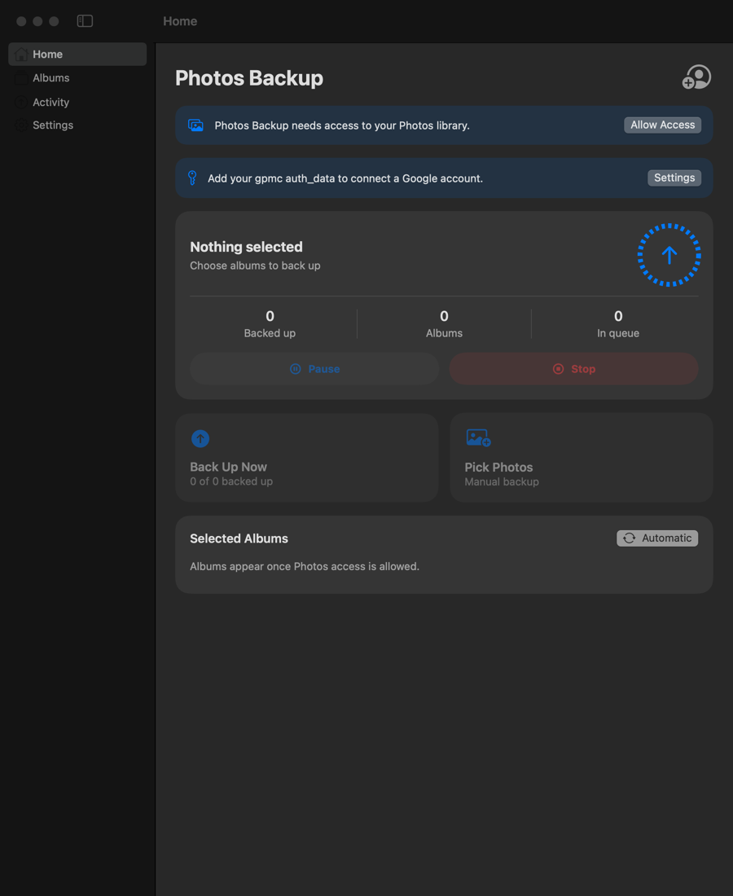
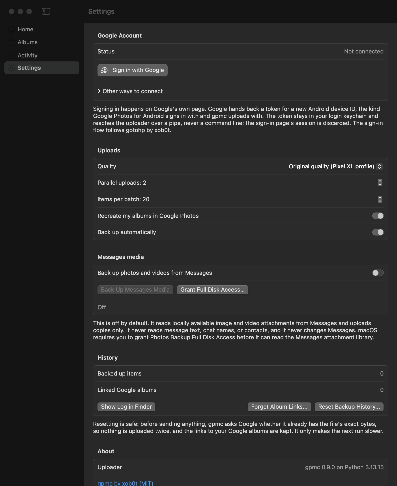

# Photos Backup for Mac

A native macOS app that backs up the albums you pick in Apple Photos to Google
Photos, in original quality and without counting against your Google storage.
It is the Mac counterpart of the "Photos Backup" iOS app: the same Home, Albums,
Activity and Settings screens, plus a menu-bar item that keeps backing up after
the window is closed.

The uploading is done by [gpmc](https://github.com/xob0t/gpmc) (xob0t, MIT),
a client for Google Photos' reverse-engineered mobile API. gpmc commits each
upload as a Pixel XL, and Google still gives that phone free original-quality
backup.

<p align="center">
  
  
</p>

## Read this first

- **The API is unofficial.** gpmc talks to an API Google never published. Google
  can change it or stop the free Pixel XL quota at any time. If that happens,
  uploads fail or start using your storage. Photos on the Mac is never changed
  either way: the app only reads it.
- **`auth_data` is a password.** It contains a long-lived Google master token
  (`Token=aas_et/...`). The app stores it in your login keychain and gives it
  to the uploader over a pipe, never in argv or the environment, where other
  processes of yours could read it. Treat it like a password: never paste it
  into an issue or a log.
- **One way, upload only.** Deleting a photo on the Mac does not delete it from
  Google Photos, and nothing comes back down from Google.

## How it works

```
Apple Photos ──PhotoKit──▶ Photos Backup.app ──JSON over a pipe──▶ gpmc_bridge.py ──▶ gpmc ──▶ Google Photos
 (albums you pick)          plan, export a batch,                   (bundled Python)      mobile API,
                            record media keys                                             "Pixel XL"
```

1. **Plan.** The app reads the selected albums through PhotoKit. Each asset
   Google has not confirmed yet is uploaded once, even if it sits in several
   albums. Your own albums go first, so a photo lands straight in its Google
   album; then smart albums; then everything else in All Photos.
2. **Export.** For each batch (20 by default), the app writes the version Photos
   shows into a staging folder: the edited rendition if there is one,
   otherwise the original. Originals still in iCloud ("Optimize Mac Storage")
   are downloaded first. Each file's modification date is set to its capture
   date, because gpmc sends that as the timestamp.
3. **Upload.** `Bridge/gpmc_bridge.py` hands the batch to gpmc one file at a
   time. gpmc hashes each file and asks Google whether it already has those
   bytes ("Already backed up"), uploads the rest, and returns a media key for
   every item. The app records each key as soon as Google confirms it. That
   hash check is also why resetting the history never uploads anything twice.
4. **Albums.** If "Recreate my albums" is on, each of your own albums gets a
   Google Photos album of the same name. It is created by its first batch, and
   later batches and later runs append to it. Smart albums and All Photos only
   upload their items.
5. **Record.** Media keys and album links go to
   `~/Library/Application Support/io.github.ayush5harma.PhotosBackup/state.json`
   after every batch, and the staging copies are deleted.

With **Automatic** on, a run starts when Photos reports a change (after it
settles for 20 seconds), every 30 minutes, and at launch. **Pause** finishes the
current batch first. **Stop** abandons the files still uploading and keeps
every one already confirmed. Anything Google committed in the last instant is
found by the hash check on the next run. An album that is being created is
always allowed to finish first, so a stop cannot leave a duplicate album
behind. Quitting the app mid-batch stops the same way before it exits.

## Get your auth_data

gpmc needs the sign-in request that Google Photos for Android sends. You only
need it once per account. The gpmc README gives two ways:
[ReVanced (no root)](https://github.com/xob0t/gpmc#option-1---revanced-no-root-required)
or [the official app on a rooted phone or emulator, via HTTP Toolkit](https://github.com/xob0t/gpmc#option-2---official-apk-root-required).
The result is one long line starting with `androidId=`. Paste it into
**Settings > Google Account** and click **Save**. The status should then show
your Google address.

## Build and run

Needs macOS 14 or later on Apple silicon, Xcode (Swift 6 toolchain), and
[uv](https://docs.astral.sh/uv/).

```sh
scripts/build-app.sh             # -> build/Photos Backup.app
scripts/build-app.sh --install   # ...and copy it to /Applications
open "build/Photos Backup.app"
```

The script compiles the app and copies a relocatable CPython 3.13 into the
bundle. That CPython is the python-build-standalone build uv installs. The
script then installs gpmc beside the bridge, precompiles the Python, draws
the icon, and signs everything from the inside out. The bundle is about 76 MB
and needs nothing else installed on the Mac.

Signing uses the first Apple Development / iPhone Developer / Developer ID
identity in your keychain; `--identity -` (or `CODESIGN_IDENTITY`) overrides
it. A real identity matters because macOS ties both the Photos permission and
the keychain item to the signature. With ad hoc signing, every rebuild asks
for both again.

On first launch: **Allow Access** to Photos, paste your auth_data, then choose
albums (All Photos starts selected).

## Settings

| Setting | Default | Meaning |
|---|---|---|
| Quality | Original, unlimited | Pixel XL. "Storage saver" commits as a Pixel 2 (recompressed, free); "uses storage" as a Pixel 8. |
| Parallel uploads | 2 | gpmc threads per batch (1-4). |
| Items per batch | 20 | Assets exported and uploaded per bridge run; also the staging space one run needs. |
| Recreate my albums | on | Mirror your own albums as Google Photos albums. |
| Back up automatically | on | Run on library changes, every 30 minutes and at launch. |

**Forget Album Links** makes the next run create fresh Google albums. Use it
after deleting the mirrored albums in Google Photos. **Reset Backup History**
forgets which items are backed up but keeps the album links; the next run
re-checks every item by hash.

## Not done yet

- Live Photos upload as their still image; the motion part is not sent.
- Shared albums and other people's items are skipped, since PhotoKit does not
  hand out their originals.
- Google caps an album at 20,000 items. gpmc splits a larger new album into
  "Name 1", "Name 2" and so on, but the app only remembers the first.
- Not notarized and Apple silicon only. An Intel build should work but has
  not been tried.
- If the response to creating a Google album is lost (a timeout, a crash, or
  a quit that outlasts the 15-second stop), the album exists but the app never
  learned its id, and the next run creates another. gpmc cannot list albums,
  so the orphan cannot be found again automatically.
- An item is uploaded once. Editing it in Photos afterwards, or deleting it
  from Google Photos, does not send it again; Reset Backup History does.
- Each batch is a new uploader process that signs in again, so the default
  batch size means one sign-in per 20 items. For very large libraries the
  next step is a long-lived uploader that reuses its token.
- No end-to-end upload test in CI: one needs a real Google account and real
  auth_data.

## Development

```sh
swift test                                          # planner, state, protocol (Swift Testing)
python3 -m unittest discover -s Bridge/tests        # the bridge against a fake gpmc client
```

- `Sources/PhotosBackupCore`: everything that needs neither PhotoKit nor a
  process: the bridge protocol, the persisted state and the planner.
- `Sources/PhotosBackup`: the app: PhotoKit library and exporter, the bridge
  runner, the engine, Keychain, SwiftUI views.
- `Bridge/gpmc_bridge.py`: the line protocol. Its docstring is the
  specification: one JSON request on stdin, NDJSON events on stdout, logs on
  stderr. The pinned gpmc version is in `Bridge/requirements.txt`.
- The bridge log is `~/Library/Application Support/io.github.ayush5harma.PhotosBackup/Logs/bridge.log`
  (Settings > Show Log in Finder).

A debug build can photograph its own window, one PNG per section, with no
Screen Recording permission. That is how the screenshots above were made. The
script runs it as a separate app (bundle id `...PhotosBackup.snapshots`), so
it never touches the real app's keychain item, history or settings, and it
never starts a backup:

```sh
scripts/build-app.sh && scripts/snapshots.sh /tmp/shots
```

## Credits

[gpmc](https://github.com/xob0t/gpmc) by xob0t does the actual talking to
Google, under the MIT license. This app is MIT too; see [LICENSE](LICENSE).
