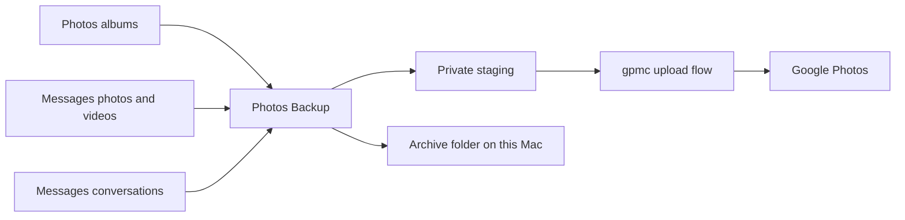

# Photos Backup for Mac

```text
          .-----------------------.       .--.
         /                         \   .-(    )-.
        |    /\          /\         | (  cloud  )
        |   /  \   /\   /  \   _     |  '-(  )-'
        |  /    \_/  \_/    \_/ \    |     '--'
        |       framed mountains     |
         \                         /
          '-----------------------'
                 selected albums
                    to backup
```

**Back up your Apple Photos albums to Google Photos, keep a readable archive
of your Messages, and run it all from the menu bar.**

A native SwiftUI app with resumable uploads, album mirroring, and a menu bar
panel that shows progress without keeping a window open. Choose your albums,
optionally add the photos and videos from Messages, and optionally keep a
private, browsable copy of every conversation in a folder on your Mac.

[Get started](#get-started) · [Automate it](#automate-it) ·
[Privacy](#privacy) · [Architecture](docs/ARCHITECTURE.md) ·
[Technical reference](docs/REFERENCE.md) · [Contributing](CONTRIBUTING.md)

Independent community project; not affiliated with Apple or Google.



## A look at the app

[](docs/menu-bar-panel-light.png)
[](docs/menu-bar-panel-backing-up-dark.png)

<details>
<summary>See the welcome guide</summary>

[](docs/welcome-guide-light.png)

</details>

Screenshots are rendered from made-up data by the app's fixture mode; they never
show a real library, account or conversation. See
[screenshot instructions](docs/SCREENSHOTS.md).

## What it does

### Photos backup

- Pick albums through PhotoKit, including originals stored in iCloud. A photo in
  several albums uploads once, and your own albums are recreated in Google Photos
  under the same names.
- Uploads resume from what Google has confirmed. A failed item is retried in the
  same run (three attempts, one, two and four seconds apart), and a Google
  "slow down" answer holds every upload for a minute or more before it carries on.
- Automatic runs wait on a metered network, in Low Data Mode, on battery or in
  Low Power Mode, as you choose. Back Up Now, chosen photos, retries and links
  run anyway.
- A photo you edit after it was backed up is uploaded again as edited. The Mac
  stays awake while a run is uploading.
- Activity shows live uploads, the last 40 runs and a redacted timeline, with
  Retry Failed, a per-item retry and the failure detail. Settings can export a
  diagnostic report that opens with a "What stands out" summary.

### Messages

Two separate features, both off until you turn them on, both needing Full Disk
Access:

- **Messages media to Google Photos.** The photos and videos from your
  conversations that are on this Mac go to Google Photos, as before.
- **Messages archive.** A private, readable copy of every conversation in a
  folder you choose (default `~/Documents/Messages Archive`): a page per
  conversation styled like Messages, the same data as `messages.json`, the
  attachments, and an index. It updates incrementally and runs once a day. Nothing
  in it leaves your Mac.

### Menu bar app

- A window-style menu bar panel with a live status item, and a menu-bar-only
  mode (turn off Show in Dock).
- Open at login, notifications for automatic runs and problems (throttled), and
  keyboard shortcuts in the Backup menu.
- A Settings window with General, Backup, Messages, Account and Advanced tabs,
  and a seven-page welcome guide on a fresh install.

The uploader uses [gpmc](https://github.com/xob0t/gpmc), an **unofficial Google
Photos API client**. Upload availability and storage accounting depend on
Google and may change. This app uploads in one direction and does not delete
anything from Apple Photos, Messages, or Google Photos.

## Get started

Requires macOS 14 or later, Apple silicon, a Swift 6 toolchain (Xcode or Command
Line Tools), and [uv](https://docs.astral.sh/uv/) for the bundled Python runtime.

```sh
git clone https://github.com/ayush5harma/photos-backup-mac.git
cd photos-backup-mac
scripts/build-app.sh
open "build/Photos Backup.app"
```

To install into `/Applications`, use `scripts/build-app.sh --install`. To sign
ad hoc instead of with a keychain identity, use `--identity -`.

1. Follow the welcome guide: allow Photos access, sign in with Google, choose
   albums, and decide about Messages, the menu bar and notifications.
2. Select **Back Up Now** in the menu bar panel or the Overview.

The app is not notarized. A stable signing identity helps macOS retain Photos
and Keychain permissions between builds. See
[build and signing details](docs/REFERENCE.md#build-and-run).

## Automate it

`photosbackup://` links run the same actions as the buttons, with or without a
window open. In Shortcuts, add an **Open URLs** action with one of these, or use
`open` from a terminal. Links are followed exactly or not at all.

| Link | Does |
| --- | --- |
| `photosbackup://backup` | Back Up Now (photos, plus Messages media when it is on) |
| `photosbackup://backup/photos` | Back up photos only |
| `photosbackup://backup/messages-media` | Back up Messages media only |
| `photosbackup://archive` | Archive Messages now (needs the archive turned on) |
| `photosbackup://pause`, `resume`, `stop` | Control the current run; `resume` only continues a paused run |
| `photosbackup://retry-failed` | Retry the items that failed |
| `photosbackup://open` | Open the window, or `open/overview`, `albums`, `messages`, `activity` |
| `photosbackup://settings` | Open Settings, or `settings/general`, `backup`, `messages`, `account`, `advanced` |

```sh
open "photosbackup://backup/photos"
```

Runs a link starts are recorded as "Shortcut or link" and are not announced as
automatic.

## Privacy

- **On your Mac.** Backup state, run history, the event timeline and logs live
  under `~/Library/Application Support/io.github.ayush5harma.PhotosBackup/`.
  Exported copies are staged temporarily in the app's Caches folder and removed
  after each batch. The Messages archive lives in the folder you choose, with
  owner-only permissions (folders 0700, files 0600). Your Google credential is
  kept in the login Keychain and reaches the uploader over a pipe.
- **To Google.** The photos and videos you select, their capture dates and your
  album names, sent to your connected Google Photos account. With Messages media
  on, the images and videos from your conversations go there too. Message text,
  chat names and contacts are never uploaded.
- **Full Disk Access.** macOS protects the Messages database and its
  attachments, and Photos permission does not cover them. Both Messages features
  need Photos Backup to have Full Disk Access in **System Settings > Privacy &
  Security**; the app reads Messages and never changes it. Contacts access is
  optional and only used to show names in the archive.
- **Reports and logs.** The timeline and the diagnostic report remove tokens,
  email addresses, phone numbers, staging paths and your home folder's name.
  Keep credentials, media and unredacted logs out of issues, and report
  vulnerabilities through [the private reporting channel](SECURITY.md).

Live Photos currently upload as still images. Known limitations are listed in
the [technical reference](docs/REFERENCE.md#not-done-yet).

The Messages media behavior comes from
[icloud-to-google-photos](https://github.com/ayush5harma/icloud-to-google-photos),
adapted to this app's native upload flow. Its emulator controls and destructive
iCloud offload are not part of this app.

## Requirements

- macOS 14 or later on Apple silicon (an Intel build should work but has not
  been tried).
- A Google account for Google Photos.
- To build: a Swift 6 toolchain and uv.
- For Messages features: Full Disk Access for Photos Backup.

## Contribute

Read [CONTRIBUTING.md](CONTRIBUTING.md) for setup, tests, and pull requests.
Reproducible bug reports, accessibility improvements, documentation, and tests
are welcome. If the app is useful, star the repository or share it with other
Mac users who need photo backups.

## License and credits

[MIT](LICENSE). Uploads use [gpmc](https://github.com/xob0t/gpmc); the sign-in
flow follows [gotohp](https://github.com/xob0t/gotohp), both by xob0t.
