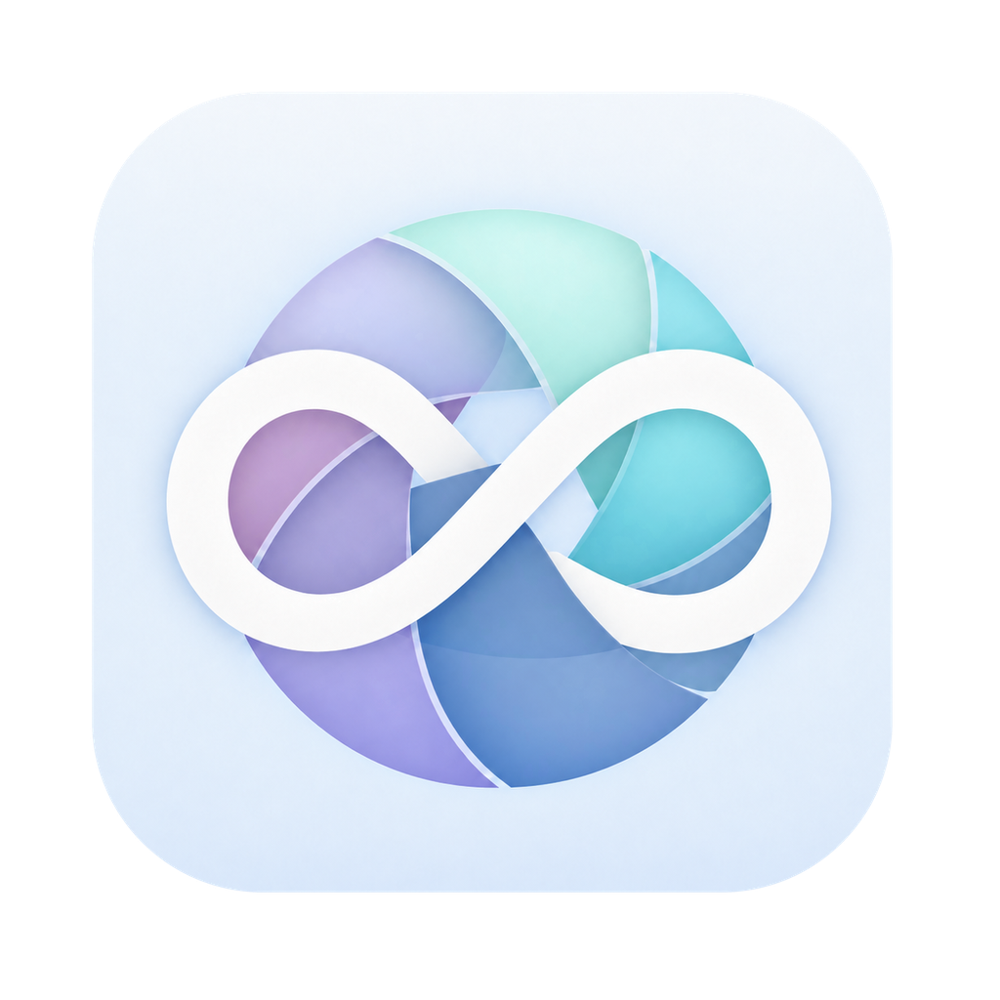
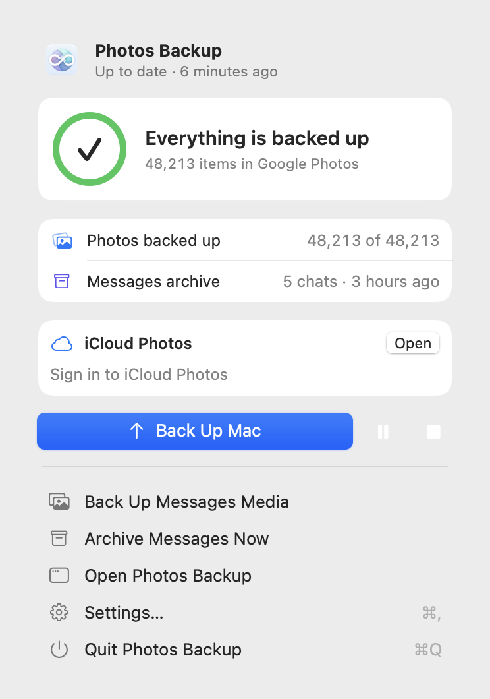
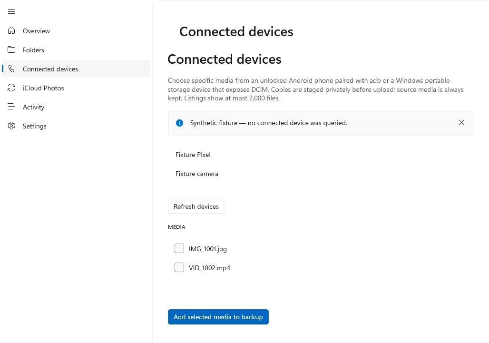
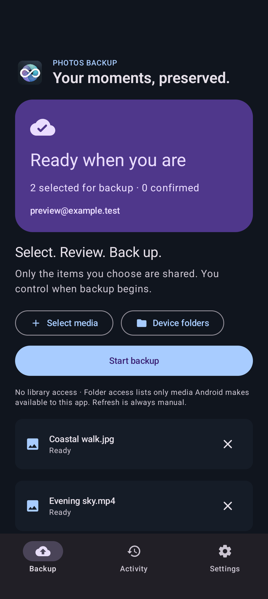
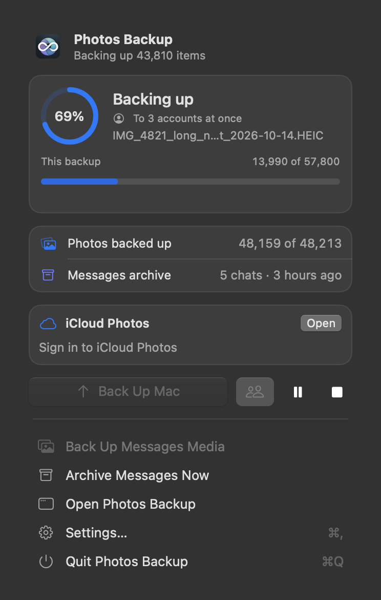
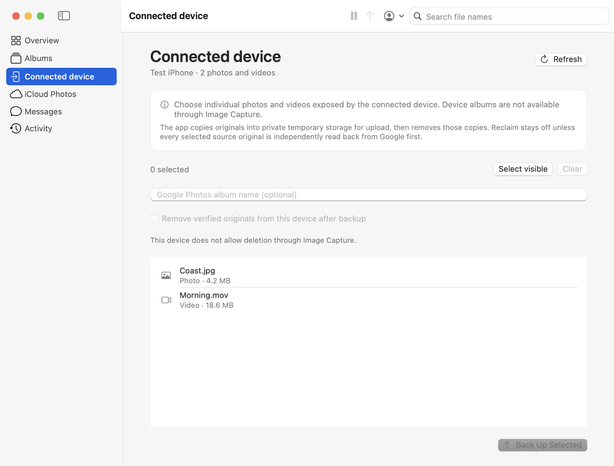

# Photos Backup

<p align="center"><picture>
  <source media="(prefers-color-scheme: dark)" srcset="docs/app-icon-dark.png">
  
</picture></p>

Photos Backup is a native app for macOS, Windows and Android that backs up your photos and videos to Google Photos at original quality.

It is unofficial: it uploads through [gpmc](https://github.com/xob0t/gpmc), a client for Google Photos' mobile API. Today, original-quality uploads made this way do not count against your Google storage. Google can change that at any time, so treat it as a bonus that may end, not a promise.

[Website](https://ayush5harma.github.io/google-photos-backup/) · [Download](https://github.com/ayush5harma/google-photos-backup/releases/latest) · [Setup guide](docs/SETUP.md) · [Reference](docs/REFERENCE.md) · [Changelog](CHANGELOG.md) · [Credits](ACKNOWLEDGEMENTS.md)

## Download

Get the files from the [latest release](https://github.com/ayush5harma/google-photos-backup/releases/latest) (v0.6.4):

| Platform | Needs | File |
| --- | --- | --- |
| Mac with Apple silicon | macOS 14 or later | [Photos-Backup-0.6.4-macOS-arm64.dmg](https://github.com/ayush5harma/google-photos-backup/releases/download/v0.6.4/Photos-Backup-0.6.4-macOS-arm64.dmg) |
| Mac with an Intel processor | macOS 14 or later | [Photos-Backup-0.6.4-macOS-x86_64.dmg](https://github.com/ayush5harma/google-photos-backup/releases/download/v0.6.4/Photos-Backup-0.6.4-macOS-x86_64.dmg) |
| Windows PC, Intel or AMD | Windows 10 (1809) or later | [Google-Photos-Backup-0.6.4-Windows-x64-Setup.exe](https://github.com/ayush5harma/google-photos-backup/releases/download/v0.6.4/Google-Photos-Backup-0.6.4-Windows-x64-Setup.exe) |
| Windows PC, ARM | Windows 11 | [Google-Photos-Backup-0.6.4-Windows-arm64-Setup.exe](https://github.com/ayush5harma/google-photos-backup/releases/download/v0.6.4/Google-Photos-Backup-0.6.4-Windows-arm64-Setup.exe) |
| Android phone or tablet | Android 8 or later | [Photos-Backup-0.6.4-Android.apk](https://github.com/ayush5harma/google-photos-backup/releases/download/v0.6.4/Photos-Backup-0.6.4-Android.apk) |

Each release has a `SHA256SUMS.txt` so you can check your download. Not sure which Windows file you need? Look under **Settings > System > About > System type**.

## Quick start

Start with a small backup, then check the result in Google Photos (quality and storage) before you back up everything.

### Mac

1. Open the DMG and drag **Photos Backup** to Applications.
2. Open the app. It is not notarized by Apple, so if macOS blocks it, go to **System Settings > Privacy & Security** and choose **Open Anyway**.
3. Follow the welcome guide: allow Photos access, sign in with Google, and choose **All Photos** or the albums you want.
4. Choose **Back Up Now**, in the window or the menu bar. Automatic backups are on by default once the guide is done; you can turn them off in **Settings > General**.

Good to know: the app is ad-hoc signed, so macOS asks for Photos access again after each update. If you update from a version before 0.6.0, macOS may also ask whether the app may use its keychain item: choose **Always Allow**.

### Windows

1. Run the `Setup.exe` for your PC. The installer is unsigned, so SmartScreen warns you: choose **More info > Run anyway**. It installs for your Windows account only; uninstall it from Windows Settings.
2. Open **Settings** and choose **Sign in with Google**.
3. Open **Folders** and add the folders you want. Subfolders are included. Turn on **Create Google Photos albums for folders** if you want an album per folder.
4. Choose **Back Up Now** on **Overview**. Keep the app open while it runs: Windows has no scheduled backups yet.

Google sign-in needs the Microsoft Edge WebView2 Runtime. See the [Windows guide](Windows/README.md) for the full requirements.

### Android

1. Download the APK on your phone and open it. Allow your browser or file manager to install apps if Android asks. Version 0.6.4 is signed with the same key as 0.5.0, so it installs over 0.5.0 as an update.
2. Tap **Connect Google Photos** and sign in.
3. Tap **Select media** to pick photos and videos, or **Device folders** to back up whole folders as albums.
4. Tap **Start backup**. A notification shows progress, and you can cancel from it.

Android has no automatic backups: nothing uploads until you start it. Battery savers on some phones can stop long backups; start the backup again to finish the rest.

## Features

**On every platform**

- Uploads at **Original quality** by default. You can also choose Storage saver, or Original quality that counts against your storage.
- Makes copies only. It never deletes photos from your device or from Google Photos (the one exception is the opt-in iCloud clean-up below).
- Skips anything Google already has, so an interrupted or repeated backup never uploads the same file twice.
- **Parallel uploads**, either automatic (the app finds the fastest level) or a fixed number you choose. Up to 32 at once on Mac and Windows; on Android up to 8 on Wi-Fi and 2 on a metered network.
- Retries passing errors, and waits when Google asks it to slow down.

**Mac**

- Backs up your whole Photos library or the albums you choose, and **mirrors your albums** as Google Photos albums with the same names.
- **Several Google accounts** back up side by side, each at its own pace. Send backups to all accounts or only the ones you tick, or back up once to a single account.
- **Hidden photos** go up only when you pick them with **Choose Photos**. They go only to the first account and never into an album.
- **Photos you remove from a Google album are never put back.** If more than 25 photos are about to be added to an album that already exists, the app waits for you to add or skip them.
- **Batch commits:** uploads are confirmed with Google up to 20 at a time, which roughly doubles how fast one account goes.
- Backs up automatically when your library changes, at launch, after the Mac wakes and every 30 minutes. It can pause on a metered network, in Low Data Mode, in Low Power Mode or on battery.
- Uploads a photo again when you edit it (you can turn this off).
- **Messages:** backs up the photos and videos in your Messages, and can keep a readable archive of your conversations on the Mac. Both need Full Disk Access.
- **iCloud Photos:** backs up straight from iCloud, without signing in to iCloud on the Mac.
- Imports photos from a connected iPhone or camera.
- A menu bar panel, keyboard shortcuts, and [`photosbackup://` links](docs/REFERENCE.md#links) for Shortcuts.

**Windows**

- Backs up the folders you choose, with an optional Google album for each folder.
- **iCloud Photos:** backs up straight from iCloud. iCloud for Windows is not needed.
- Imports from connected phones and cameras, and optionally from an Android phone over wireless ADB.
- Pause, resume or stop a backup.

**Android**

- Backs up photos and videos you pick with Android's photo picker, which needs no permission.
- Backs up device folders and mirrors each folder's name as a Google album. If you allow access to only some photos, only those appear.

**iCloud clean-up (experimental, Mac and Windows).** iCloud backups are copy-only unless you turn this on. When you do, the app downloads each original from iCloud and from Google Photos again, checks they match byte for byte, and only then moves the iCloud item to Recently Deleted. You either review a preview and confirm it, or allow automatic runs of up to 100 items. Recently Deleted does not free space right away, and the clean-up has not yet been tested end to end with real deletions.

**Not supported yet:** On the Mac, Live Photos upload as their still image only, and shared albums are skipped. A full Google account shows up as failed items rather than a clear message. The iCloud source may not work with Advanced Data Protection. More limits are in the [reference](docs/REFERENCE.md#not-done-yet).

## Speed

Google limits how fast a single account accepts new uploads, so a fast connection alone does not make one account fast. That is why the Mac app runs several accounts side by side and confirms uploads in batches. Measured on 2026-11-06 on a 177 Mbit/s uplink: about 138 Mbit/s and 5.7 photos a second across three accounts at 16 uploads each.

## Original quality and Google storage

The uploader presents itself to Google as a Pixel XL phone. On 16 October 2026, a photo and a video from each platform were uploaded, showed in Google Photos as Original quality without using account storage, and downloaded back with matching SHA-256 hashes ([validation report](https://github.com/ayush5harma/google-photos-backup/releases/download/v0.4.0/live-validation.md)).

That was a small test, not a guarantee. Google can change sign-in, uploads or storage accounting at any time. To check your own account, note your storage at [one.google.com/storage](https://one.google.com/storage), back up one large video, and look again the next day.

## Privacy and safety

- **Your sign-in stays on your device.** It is kept in the macOS Keychain, encrypted with Windows DPAPI, or encrypted with an Android Keystore key. On Mac and Windows it reaches the uploader through a pipe, never on a command line. It works like a password, so never paste it into an issue or a log.
- **Your media goes only to your Google account.** The iCloud source also talks to Apple. There are no analytics.
- **History and logs stay on your device.** On the Mac, the timeline and the diagnostic report remove tokens, email addresses, phone numbers and your user name, but read a report before you share it.
- **The Messages archive is a private local folder.** It is never uploaded by the app, but if you put it in a synced folder, it syncs.
- Found a security problem? See [SECURITY.md](SECURITY.md).

## Screenshots

These show made-up demo data.

| macOS | Windows |
| --- | --- |
|  |  |

<details><summary>Android, dark mode and connected iPhone import</summary>





<picture>
  <source media="(prefers-color-scheme: dark)" srcset="docs/macos-connected-device-dark.png">
  
</picture>

</details>

## Build from source

On a Mac with macOS 14 or later, Xcode 26 or later and [uv](https://docs.astral.sh/uv/):

```sh
git clone https://github.com/ayush5harma/google-photos-backup.git
cd google-photos-backup
scripts/build-app.sh                              # builds "build/Photos Backup.app"
swift test                                        # app tests
python3 -B -m unittest discover -s Bridge/tests   # uploader tests, against a fake Google
```

The [Windows guide](Windows/README.md#build-on-windows) and the [Android guide](Android/README.md#build) cover the other apps. [CONTRIBUTING.md](CONTRIBUTING.md) explains the test layers and the end-to-end run, and [ARCHITECTURE.md](docs/ARCHITECTURE.md) shows how the pieces fit.

## What's new

- **0.6.4:** Uploads are confirmed with Google up to 20 at a time on the Mac, about doubling one account's speed. A new Android APK, the first since 0.5.0, brings parallel uploads to Android.
- **0.6.3:** Each Google account uploads at its own pace, so a fast account never waits for a slow one.
- **0.6.2:** Several Google accounts back up at the same time. Faster uploads on Windows and for iCloud backups.
- **0.6.1:** A fixed number of parallel uploads is used from the first batch, and up to 32 can run at once.
- **0.6.0:** Back up to several Google accounts, with album safeguards that never put removed photos back.

The full history is in [CHANGELOG.md](CHANGELOG.md) and on the [releases page](https://github.com/ayush5harma/google-photos-backup/releases).

## Credits

Made possible by [gpmc](https://github.com/xob0t/gpmc) and [gotohp](https://github.com/xob0t/gotohp) by **xob0t**, [iCloud Photos Downloader](https://github.com/icloud-photos-downloader/icloud_photos_downloader), and the projects listed in [Acknowledgements](ACKNOWLEDGEMENTS.md). Photos Backup is [MIT licensed](LICENSE); upstream projects keep their own licenses.
