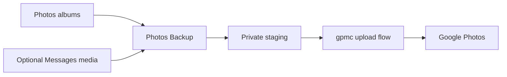
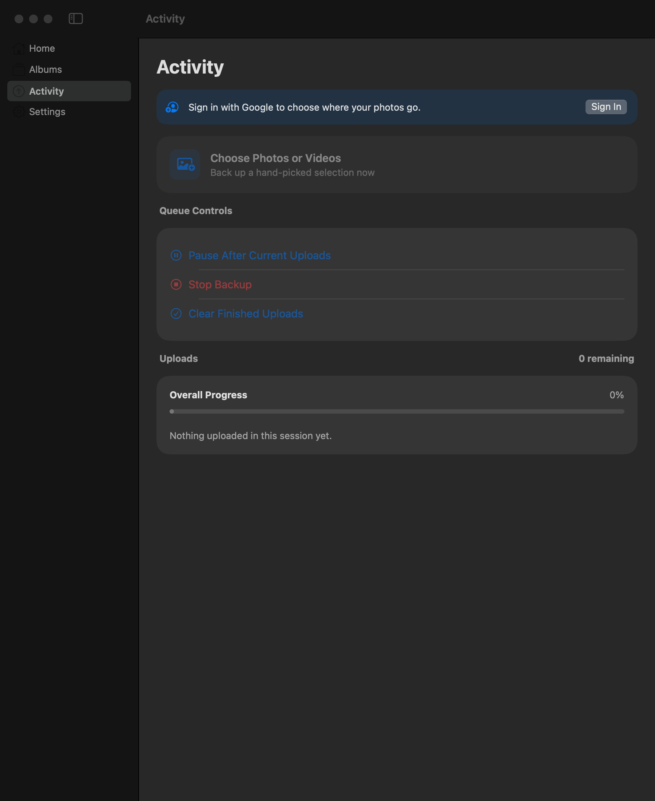

# Photos Backup for Mac

```text
          .-----------------------.       .--.
         /                         \   .-(    )-.
        |    /\          /\         | (  cloud  )
        |   /  \   /\   /  \   _     |  '-(  )-'
        |  /    \_/  \_/    \_/ \    |     '--'
        |       framed mountains     |
         \                         /
          '-----------------------'
                 selected albums
                    to backup
```

**Back up selected Apple Photos albums and Messages media to Google Photos.**

A native SwiftUI app with resumable uploads, album mirroring, and menu-bar
controls. Choose your photo albums, optionally include locally downloaded
Messages photos and videos, and follow progress without keeping a window open.

[Get started](#get-started) · [Messages media](#messages-media) ·
[Architecture](docs/ARCHITECTURE.md) · [Technical reference](docs/REFERENCE.md) ·
[Contributing](CONTRIBUTING.md)

Independent community project; not affiliated with Apple or Google.



## A look at the app

[](docs/home.png)

<details>
<summary>See settings and activity</summary>

[](docs/settings.png)
[](docs/activity.png)

</details>

Screenshots are captured from an isolated app instance without a connected
account or personal media. See [screenshot instructions](docs/SCREENSHOTS.md).

## Features

- Select albums through PhotoKit, including originals stored in iCloud.
- Resume from confirmed uploads and recreate selected albums in Google Photos.
- Add Messages images and videos as an explicit, optional backup source.
- Pause, resume, stop, refresh, and check backup status from the menu bar.
- Keep account credentials in the macOS login Keychain.

The uploader uses [gpmc](https://github.com/xob0t/gpmc), an **unofficial Google
Photos API client**. Upload availability and storage accounting depend on
Google and may change. This app uploads in one direction and does not delete
anything from Apple Photos, Messages, or Google Photos.

## Get started

Requires macOS 14+, Apple silicon, a Swift 6 toolchain (Xcode or Command Line
Tools), and [uv](https://docs.astral.sh/uv/) for the bundled Python runtime.

```sh
git clone https://github.com/ayush5harma/photos-backup-mac.git
cd photos-backup-mac
scripts/build-app.sh
open "build/Photos Backup.app"
```

To install into `/Applications`, use `scripts/build-app.sh --install`.

1. Grant Photos access if you want to back up your photo library.
2. Open **Settings > Sign in with Google** and connect your account.
3. Choose albums, then select **Back Up Now**.

The app is not notarized. A stable signing identity helps macOS retain Photos
and Keychain permissions between builds. See [build and signing details](docs/REFERENCE.md#build-and-run).

## Messages media

Messages backup is **off by default**. Enable it in Settings and grant
**Photos Backup** Full Disk Access in **System Settings > Privacy & Security**.
Photos permission alone does not grant access to Messages.

Only locally available image and video attachments are included. The app does
not upload message text or contacts, download missing attachments from iCloud,
or remove source files. These attachments are sent to your connected Google
Photos account, so enable this only if that is where you want them backed up.

The menu shows Messages status and provides access to Full Disk Access settings
when needed. Unavailable Messages access is reported without blocking Photos
backups.

The source behavior comes from
[icloud-to-google-photos](https://github.com/ayush5harma/icloud-to-google-photos),
adapted to this app's native upload flow. Its emulator controls and destructive
iCloud offload are not part of this app.

## Data and privacy

Credentials stay in Keychain and reach the uploader over a pipe. Backup state
and logs live under the app's Application Support directory; exported copies
are staged temporarily. Keep credentials, media, and unredacted logs out of
issues. Report vulnerabilities through [the private reporting channel](SECURITY.md).

Live Photos currently upload as still images. Shared albums, edits after a
confirmed backup, and large-album behavior have limitations documented in the
[technical reference](docs/REFERENCE.md#not-done-yet).

## Contribute

Read [CONTRIBUTING.md](CONTRIBUTING.md) for setup, tests, and pull requests.
Reproducible bug reports, accessibility improvements, documentation, and tests
are welcome. If the app is useful, star the repository or share it with other
Mac users who need photo backups.

## License and credits

[MIT](LICENSE). Uploads use [gpmc](https://github.com/xob0t/gpmc); the sign-in
flow follows [gotohp](https://github.com/xob0t/gotohp), both by xob0t.
