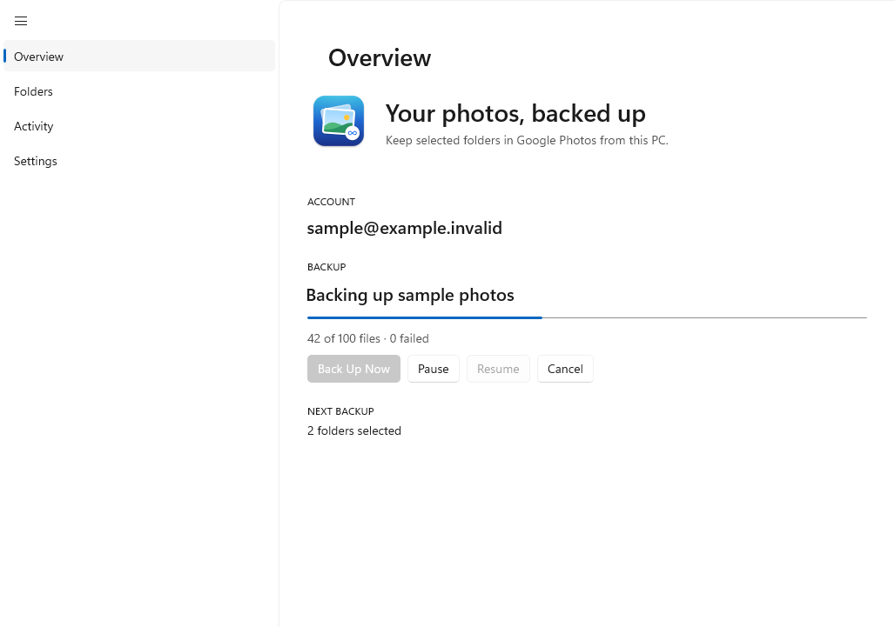
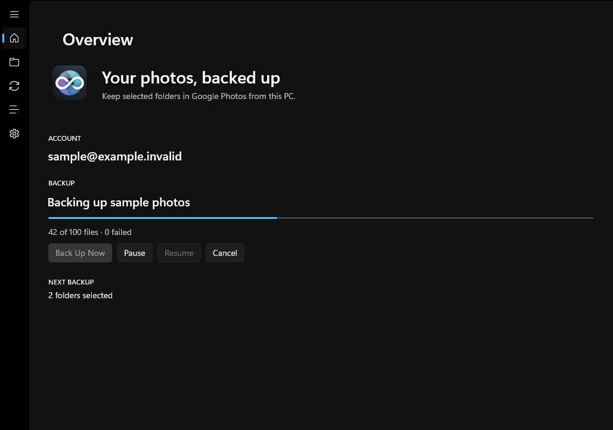

# Google Photos Backup for Windows

A native WinUI 3 app for backing up selected photo and video folders to Google Photos. It uses Windows App SDK, .NET, and the shared pinned [gpmc](https://github.com/xob0t/gpmc) uploader.

It is an unsigned preview release. Google Photos access uses an unofficial API, so Google can change authentication, uploads, or storage accounting at any time.

## Download

The v0.4.0 packages are listed on the [latest release](https://github.com/ayush5harma/google-photos-backup/releases/latest). Choose your native architecture under **Settings > System > About > System type**:

| System | Per-user installer |
| --- | --- |
| ARM64 | `Google-Photos-Backup-0.4.0-Windows-arm64-Setup.exe` |
| Intel or AMD x64 | `Google-Photos-Backup-0.4.0-Windows-x64-Setup.exe` |

Run `Setup.exe` to install under your account's `%LOCALAPPDATA%\Programs\Google Photos Backup`; uninstall through Windows Settings. The installer includes .NET, Windows App SDK, native Python, and backup providers. Verify downloads with the release's `SHA256SUMS.txt`.

The x64 build targets Windows 10 version 1809 or later; use Windows 11 for ARM64 and for the native Mica appearance. ARM64 packages contain native ARM64 app and provider binaries. Google sign-in requires Microsoft Edge WebView2 Runtime. Follow Microsoft's [Windows App SDK runtime prerequisites](https://learn.microsoft.com/en-us/windows/apps/windows-app-sdk/deployment-architecture), including the Visual C++ Redistributable for your package's architecture (x64 or ARM64). A clean installation without that redistributable has not been tested. The app and installer are unsigned, so Windows may warn when opening them; inspect the source and build provenance before trusting a preview.

## A look at the preview

<picture>
  <source media="(prefers-color-scheme: dark)" srcset="../docs/windows-overview-dark.png">
  
</picture>

This is the actual WinUI window rendered with synthetic data in [verified Windows CI run 38797533801](https://github.com/ayush5harma/google-photos-backup/actions/runs/38797533801). The fixture uses an opaque theme background so Mica transparency is readable in a PNG; the normal app retains its system backdrop.

## Compact navigation



The hamburger button switches between labeled navigation and a compact icon rail. Hover an icon for its label; reopening restores the full labels. This screenshot uses synthetic data from the fixed preview build.

## Set up and back up

1. Open **Settings** and choose **Sign in with Google**. Complete Google's sign-in in the embedded window. The app checks the resulting credential before saving it, encrypted with Windows DPAPI for your Windows account.
2. Open **Folders** and add the photo or video folders you want to back up. Subfolders are scanned too. Nested symbolic links and reparse points are skipped; select a real folder as the root. An unreadable source stops the scan rather than reporting a successful backup.
3. Choose your upload quality in **Settings**. Original quality uses gpmc's Pixel XL mode. Google determines storage accounting; verify your account after a small initial backup. A finite test is not a guarantee of unlimited storage.
4. Enable album mirroring if you want each selected root folder represented as an album in Google Photos.
5. Open **Overview** and start a backup. Keep the app open. You can pause between batches, resume, or stop the run. **Activity** shows completed runs and failure counts.

Only confirmed uploads enter the local resume state. A later run skips unchanged, confirmed files and retries pending files and album updates; edited files may upload again. Overlapping folder selections are deduplicated. The app uploads copies and does not delete source files or Google Photos media.

This preview does not yet provide automatic scheduling, a tray app, Windows Photos library integration, or the macOS Messages features.

## Windows verification

Both v0.4.0 installers passed native architecture CI. ARM64 was also installed and exercised in Parallels on Windows 11 ARM64. On 2026-10-16, a real Google sign-in and selected photo/video upload were checked against Google Photos: items reported Original quality and no account-storage use, downloaded originals matched source SHA-256 hashes, and mirrored albums kept their source name and contents. This is evidence for those fixtures, not a promise that future uploads have unlimited storage. See the [live validation report](https://github.com/ayush5harma/google-photos-backup/releases/download/v0.4.0/live-validation.md).

CI also verifies PE architecture, application version, provider imports, package relocation, and a silent installer installation with synthetic UI checks. It cannot cover every Windows configuration.

## Local data

Settings, history, and account-specific resume state are stored in `%LOCALAPPDATA%\GooglePhotosBackup`. Credentials are encrypted with DPAPI `CurrentUser` and sent to the uploader through standard input, not command-line arguments. Disconnecting removes the saved credential. Deleting resume state can cause files to be reconsidered on the next run.

Selected media and optional album names are sent to Google Photos using an unofficial API. Google may change authentication, upload behavior, and storage accounting. Read the repository's [privacy notes](../README.md#know-before-backing-up) and [credits](../ACKNOWLEDGEMENTS.md).

## Build on Windows

Use a native Windows x64 or ARM64 host with PowerShell 7, .NET 10 SDK, the Windows SDK and C++ build tools required by WinUI 3, [uv](https://docs.astral.sh/uv/), and [Inno Setup 6](https://jrsoftware.org/isinfo.php). Visual Studio with the WinUI application development workload supplies the native build tools. Build on the target architecture: the script refuses a mismatched host, and a missing native Python distribution or provider dependency fails the build. Run from the repository root:

```powershell
git clone https://github.com/ayush5harma/google-photos-backup.git
cd google-photos-backup
./scripts/build-windows.ps1 -Architecture x64
# On a native Windows ARM64 host:
./scripts/build-windows.ps1 -Architecture arm64
```

The script reads the release version from the root `VERSION` file, publishes the self-contained app, bundles native Python 3.13 and the backup providers, verifies native binaries and imports, and tests ZIP relocation and a silent installer installation. Output is the matching versioned `.zip` and `-Setup.exe` under `build/windows/`, with SHA-256 checksums and reports under `build/windows/verification/`. It finds `ISCC.exe` on `PATH` or in the standard Inno Setup 6 installation directories; pass `-InnoCompiler 'C:\path\to\ISCC.exe'` for another location. The smoke test uses synthetic content, checks an encrypted credential round trip, and captures the actual WinUI window without signing in or uploading anything.

Run the core and bridge tests separately:

```powershell
dotnet test Windows/GooglePhotosBackup.Core.Tests/GooglePhotosBackup.Core.Tests.csproj -c Release
uv run --no-project --python 3.13 python -B -m unittest discover -s Bridge/tests
```

## iCloud Photos

The Windows preview includes an iCloud Photos source. Connect Google first, then open **iCloud Photos** and follow the Apple Account password and verification-code prompts. An iCloud for Windows installation or existing Windows iCloud sign-in is not required. Expired sessions return you to sign-in rather than silently reporting success.

See [iCloud setup and limitations](../docs/SETUP.md#icloud-photos-backup). This version retains the iCloud originals; automatic source deletion is not enabled.
