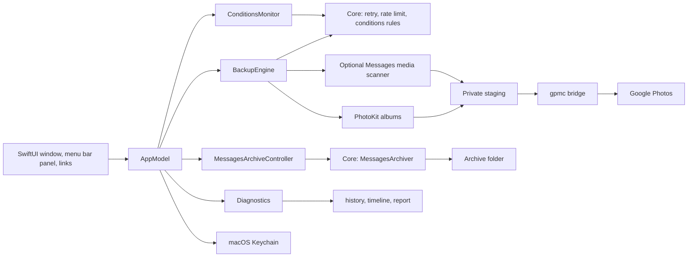

# Architecture

Photos Backup is a native SwiftUI app that discovers selected PhotoKit albums,
stages export material privately, and drives Google Photos uploads through the
bundled gpmc bridge. It can also back up Messages media the same way and write
a readable Messages archive to a folder on the Mac. It uploads in one
direction and never deletes sources.

## Layers

`Sources/PhotosBackupCore` has no PhotoKit, AppKit or process dependencies, so
it is covered by `swift test`. `Sources/PhotosBackup` is the app that wires it to
the system.

**Engine policy in Core.** The decisions of a run are pure types:
`FailureClassifier` reads Google's message into rate-limited, retryable or
permanent; `RetryPolicy` and `RetryTracker` give three attempts with a capped
backoff; `RateLimiter` holds every upload after an HTTP 429; `ConditionsEvaluator`
turns network and power conditions plus the four pause settings into one wait
reason; `EditStamp` in the backup state tells whether a photo was edited after
its backup; `RunTally` counts each item once per run. The `BackupEngine` in the
app calls them between bridge runs.

**Conditions.** `ConditionsMonitor` watches the network path and power state
and feeds `ConditionsEvaluator`. An automatic run that is blocked never starts;
a running one waits and checks again every second. A cleared condition starts an
automatic run.

**History and diagnostics.** `RunHistory` (40 runs) and `EventLog` (400 events,
14 days) are Core values persisted by `RecordStore`, which moves an unreadable
file aside. `Redactor` cleans every message on the way in. `Diagnostics` in the
app owns both stores, measures storage, cleans up, and builds the report with
Core's `DiagnosticReport`, whose rules produce "What stands out".

**Messages archive pipeline.** `MessagesArchiveController` runs Core's
`MessagesArchiver` off the main actor. The archiver copies Messages' database
to a temporary file, reads chats, handles and messages (`MessagesDatabase`,
decoding text from the attributed body with `TypedStream`), builds each
transcript (`TranscriptBuilder`, with `HandleNames` from Contacts when allowed),
renders pages (`ArchiveHTML`), copies attachments that are on the Mac, keeps
dated database copies, and records signatures in `ArchiveManifest` so the next
run skips unchanged conversations. `ArchiveFiles` applies the 0700/0600 rules and
writes through a temporary file. The controller schedules a daily run, with a
six-hour pause after a failed automatic run.

**Mac shell.** The window, a window-style `MenuBarExtra` and the Settings scene
share one `AppModel`. Core's `MenuBarStatus` reduces the engine to the single
line and symbol shown in the menu bar, the panel and the window subtitle.
`Notifier` turns run outcomes and problems into notifications, with Core's
`ProblemThrottle` allowing one per category per hour. `LoginItem` registers the
app for Open at login. `AutomationCommand` (Core) parses `photosbackup://` links
and `Automation.swift` runs them through the same methods as the buttons.

## Sandboxing and test hooks

`AppEnvironment` is the one place that decides where data lives. In debug
builds only, `PHOTOS_BACKUP_SANDBOX=<dir>` moves Application Support, Caches,
the preferences suite and the Keychain item under that folder, while the bundle
identifier stays the real one so privacy grants carry over. Release builds
ignore the variable.

`E2EHooks` (debug builds, sandboxed runs only) adds `photosbackup://debug/...`
links and a `<sandbox>/inbox` folder of link files, so `scripts/e2e.py` can drive
the app and read its state back. `SnapshotFixture` fills a sandboxed instance
with made-up data and renders every screen for the documentation. Neither is in
a release build. See [CONTRIBUTING.md](../CONTRIBUTING.md).

## Trust boundaries

Photos access is granted by macOS. Messages media scanning and the Messages
archive are off by default and read-only; both require Full Disk Access and use
only locally available attachments. Media scanning uploads only images and
videos, never message text, contacts, or missing iCloud attachments. The archive
writes message text to a folder on this Mac and uploads nothing.

Credentials remain in the login Keychain. The app keeps resumable state and
logs in Application Support, and stages exports temporarily before sending
them through gpmc to the connected Google account. Google API behaviour and
storage accounting are external dependencies.

## File map

| Path | Responsibility |
| --- | --- |
| `Sources/PhotosBackupCore/` | rules and data without system dependencies: protocol, state, retry, conditions, history, report, links, Messages archive |
| `Sources/PhotosBackup/` | SwiftUI app, PhotoKit discovery, engine, menu bar, Settings, notifications |
| `Tests/` | Swift tests, and the fake gpmc for the end-to-end run |
| `Bridge/gpmc_bridge.py` | native process boundary for gpmc upload operations |
| `scripts/build-app.sh` | app build, signing, and optional install |
| `scripts/e2e.py` | end-to-end run against a fake Google |
| `scripts/snapshots.sh` | fixture screenshots |
| `docs/SCREENSHOTS.md` | screenshot workflow |
| `docs/REFERENCE.md` | limitations, signing, and operational detail |

The Messages scanner, the archive and the private staging area are
intentionally separate from the Photos permission boundary. See the README
before enabling either Messages feature.

## Messages media scan lifecycle

Each pass reads attachment metadata from a temporary database snapshot, checks
that local files remain inside the attachment directory, and identifies media
by SHA-256. Only privately staged copies with verified hashes reach the uploader.
Confirmed upload IDs are scoped to the connected account. Stop, account changes,
and disabling Messages invalidate pending scan results.

Scans have a five-minute budget and persist a row cursor to reach later files
on subsequent passes. A completed pass wraps to the beginning so attachments
downloaded later can be discovered. This reconciliation rehashes older local
files; large libraries can therefore incur recurring disk work even when no
new upload is needed.
