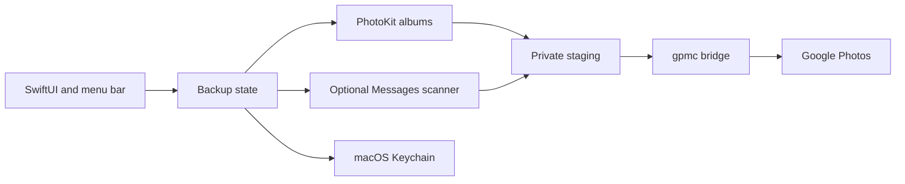

# Architecture

Photos Backup is a native SwiftUI app that discovers selected PhotoKit albums,
stages export material privately, and drives Google Photos uploads through the
bundled gpmc bridge. It uploads in one direction and never deletes sources.

## Trust boundaries

Photos access is granted by macOS. Messages scanning is off by default and is
read-only; it requires Full Disk Access and considers only locally available
image and video attachments. It never uploads message text, contacts, or
missing iCloud attachments.

Credentials remain in the login Keychain. The app keeps resumable state and
logs in Application Support, and stages exports temporarily before sending
them through gpmc to the connected Google account. Google API behaviour and
storage accounting are external dependencies.

## File map

| Path | Responsibility |
| --- | --- |
| `Sources/` | SwiftUI UI, PhotoKit discovery, selection, and backup state |
| `Bridge/gpmc_bridge.py` | native process boundary for gpmc upload operations |
| `scripts/build-app.sh` | app build, signing, and optional install |
| `docs/SCREENSHOTS.md` | isolated screenshot workflow |
| `docs/REFERENCE.md` | limitations, signing, and operational detail |

The Messages scanner and private staging area are intentionally separate from
the Photos permission boundary. See the README before enabling Messages media.

## Messages scan lifecycle

Each pass reads attachment metadata from a temporary database snapshot, checks
that local files remain inside the attachment directory, and identifies media
by SHA-256. Only privately staged copies with verified hashes reach the uploader.
Confirmed upload IDs are scoped to the connected account. Stop, account changes,
and disabling Messages invalidate pending scan results.

Scans have a five-minute budget and persist a row cursor to reach later files
on subsequent passes. A completed pass wraps to the beginning so attachments
downloaded later can be discovered. This reconciliation rehashes older local
files; large libraries can therefore incur recurring disk work even when no
new upload is needed.
