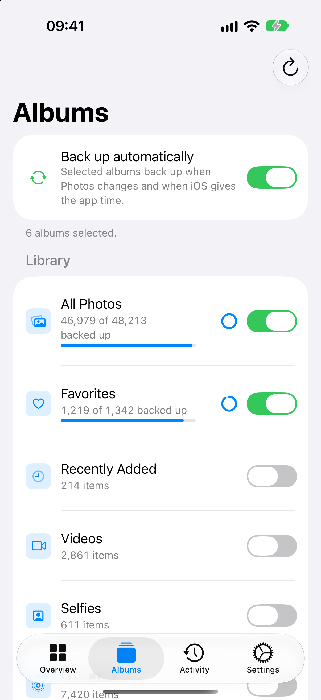
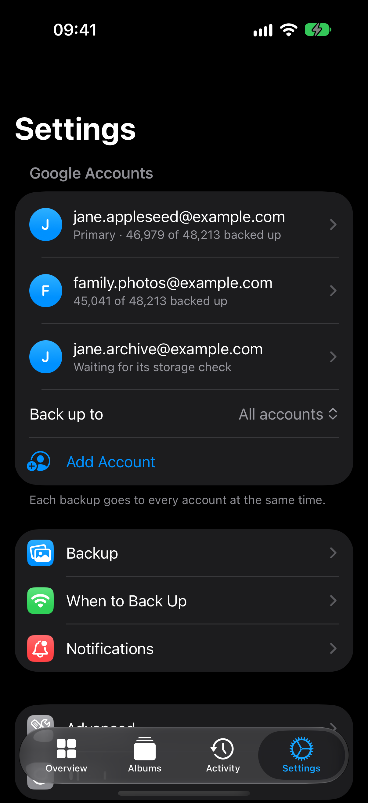

# Photos Backup for iOS

A native iPhone and iPad app that backs up the Photos albums you choose to
Google Photos, with the same design, settings and records as the Mac app. It
reuses the shared Swift core (`Sources/PhotosBackupCore`): accounts and their
backup records, the planner, the timeline and history, the diagnostic report,
`photosbackup://` links and the Google sign-in exchange.

<p>
  
  
  
</p>

## What it does

- Backs up the albums you choose (All Photos, smart albums, your own albums)
  to one or several Google accounts at the same time. Each photo is exported
  from Photos once, hashed, and sent to every account that needs it; Google
  is asked first whether it already has the bytes, uploads are committed 20
  at a time, and nothing is recorded as backed up until Google returns a
  media key for it.
- Recreates your own albums in Google Photos, adding new photos to them on
  later runs. Edited photos are uploaded again as edited (Settings > Backup).
- Pause, Resume, Stop and Retry Failed work as on the Mac. Google's "slow
  down" answers hold the account and the run carries on by itself.
- When to back up: Wi-Fi only, not in Low Data Mode, only while charging, not
  in Low Power Mode. Automatic backups wait while one holds and continue when
  it clears; Back Up Now in the app runs anyway. A `photosbackup://backup`
  link from Shortcuts or another app waits like an automatic backup (unlike
  the Mac, where a link runs at once), so a Shortcut never spends cellular
  data you chose to spare.
- Overview, Albums, Activity and Settings, light and dark, iPhone and iPad (a
  sidebar on iPad from iOS 18). Sign-in on Google's own page; each account's
  sign-in stays in the Keychain on the device. A shareable diagnostic report
  with addresses and tokens removed. Notifications for finished automatic
  backups and for problems that need you, if you allow them.
- With Photos access limited to chosen photos, only those are backed up, and
  the app says so.

It uploads through a native Swift client for Google Photos' mobile interface
(the same protocol as [gpmc](https://github.com/xob0t/gpmc), which the Mac app
uses); there is no Python on the phone.

## In the background

- A backup you start keeps going after you leave the app: on iOS 26 and later
  as a continued background task with the system's progress indicator; on
  earlier versions for the short time iOS allows, enough to finish the
  commits in flight and save. While it runs in front, the screen stays awake.
- Automatic backups run when iOS gives the app time (a background processing
  task, which needs a network, and external power if you chose Only while
  charging), and when Photos changes while the app is open. iOS decides when
  and for how long; a run it ends early is saved and the next one carries on.

## Build from source

Needs macOS with Xcode 26 or later. From the repository root:

```sh
scripts/build-ios.sh --simulator   # Debug build for the iOS Simulator; prints the .app path
scripts/build-ios.sh               # unsigned build/Photos-Backup-<version>-iOS.ipa (+ .sha256)
```

The second command checks the IPA it made: an arm64 app, the version from
`VERSION`, iOS 17.0 or later, the bundle identifier, and no signature or
provisioning profile. `--out DIR` writes elsewhere and `BUILD_NUMBER` sets the
build number. You can also open `iOS/PhotosBackup.xcodeproj` in Xcode; choose
your own team under Signing to run it on a device.

## Install

The IPA is unsigned, so iOS installs it only after a sideloading tool signs it
with your Apple ID: [AltStore](https://altstore.io),
[SideStore](https://sidestore.io), [Feather](https://github.com/khcrysalis/Feather)
or a signing service. Apps signed with a free Apple ID stop opening after 7
days until they are signed again; a paid developer account lasts a year.

## Not on iOS

- Messages media and the Messages archive, iCloud Photos as a separate
  source, and connected devices are Mac-only.
- Photos limited to "selected photos" back up only what you shared with the
  app; All Photos then means those.

## Tested, and not yet

`scripts/ios-e2e.sh` (needs `ffmpeg` for its test media) runs the app in a
throwaway iOS simulator against the fake Google in `Tests/E2E`: a first backup
of generated photos and a video into an album, a second run that uploads
nothing new, a launch that hands the background-task handler a stand-in task
before any scene exists (as a cold launch for a background task does) and
must upload one new photo in that task's own run, and a fresh run against a
fake that refuses batched commits and answers 429 twice. Every check compares
the fake's library and albums with the app's own records. The simulator
cannot submit a real background task request ("BGTaskScheduler is not
available on this platform"), hence the stand-in. `swift test` covers the upload and album decisions
(`Sources/PhotosBackupCore/NativeUpload`).

Not verified: a real Google sign-in followed by a real upload, real
background tasks (processing and, on iOS 26, continued processing) on a
physical device, and installing the IPA on a device.

Photos Backup is not made by Google. It uses Google Photos' unofficial mobile
interface, as an Android phone would; Google can change or end that at any
time. See [ACKNOWLEDGEMENTS.md](../ACKNOWLEDGEMENTS.md) for the projects it
builds on.
