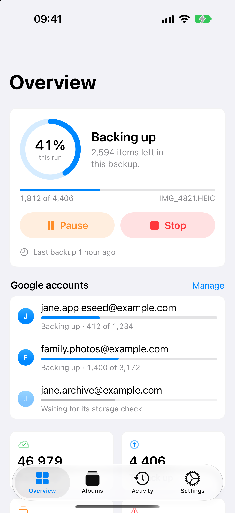

# Photos Backup for iOS

A native iPhone and iPad app that backs up the Photos albums you choose to
Google Photos, with the same design, settings and records as the Mac app. It
reuses the shared Swift core (`Sources/PhotosBackupCore`): accounts and their
backup records, the planner, the timeline and history, the diagnostic report,
`photosbackup://` links and the Google sign-in exchange.

<p>
  
  
  
</p>

## Status: preview, uploads not included yet

This version has everything but the backup engine:

- Overview, Albums, Activity and Settings, light and dark, iPhone and iPad (a
  sidebar on iPad from iOS 18).
- Sign in to one or several Google accounts on Google's own page; each
  account's sign-in is kept in the Keychain on the device.
- Choose albums (All Photos, smart albums, your own albums), back up to all
  accounts or the ones you choose, upload quality, recreating albums, and
  when to back up: Wi-Fi only, not in Low Data Mode, only while charging, not
  in Low Power Mode.
- A shareable diagnostic report with addresses and tokens removed.

Back Up Now, Pause and the `photosbackup://backup` links do not upload yet:
they record in Activity's timeline that this build does not upload. Exporting,
uploading, recreating albums and running in the background come in the next
version.

## Build from source

Needs macOS with Xcode 26 or later. From the repository root:

```sh
scripts/build-ios.sh --simulator   # Debug build for the iOS Simulator; prints the .app path
scripts/build-ios.sh               # unsigned build/Photos-Backup-<version>-iOS.ipa (+ .sha256)
```

The second command checks the IPA it made: an arm64 app, the version from
`VERSION`, iOS 17.0 or later, the bundle identifier, and no signature or
provisioning profile. `--out DIR` writes elsewhere and `BUILD_NUMBER` sets the
build number. You can also open `iOS/PhotosBackup.xcodeproj` in Xcode; choose
your own team under Signing to run it on a device.

## Install

The IPA is unsigned, so iOS installs it only after a sideloading tool signs it
with your Apple ID: [AltStore](https://altstore.io),
[SideStore](https://sidestore.io), [Feather](https://github.com/khcrysalis/Feather)
or a signing service. Apps signed with a free Apple ID stop opening after 7
days until they are signed again; a paid developer account lasts a year.

## Not on iOS

- Messages media and the Messages archive, iCloud Photos as a separate
  source, and connected devices are Mac-only.
- Photos limited to "selected photos" back up only what you shared with the
  app; All Photos then means those.

## Not verified yet

A real Google sign-in followed by a real upload, and installing the IPA on a
physical device, have not been tested. The app has run in the iOS 27
simulator, where Google's sign-in page loads and every screen was checked with
made-up data (`docs/SCREENSHOTS.md`).

Photos Backup is not made by Google. It uses Google Photos' unofficial mobile
interface, as an Android phone would; Google can change or end that at any
time. See [ACKNOWLEDGEMENTS.md](../ACKNOWLEDGEMENTS.md) for the projects it
builds on.
